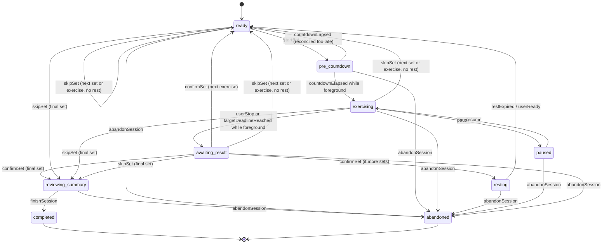

# Workout Domain + Deterministic State Machine

## 1. Bounded contexts
- **Catalog**: definition of exercise, equipment, cues, progression relationships, media; immutable-by-version snapshots.
- **Planning**: repeatable plan/workout templates, target prescriptions.
- **Execution**: actual workout sessions, exercises and sets, timer phases.
- **Journal**: actual results, note, RPE, subjective pain flag.
- **Sync**: mutations and server change feed.
- **Coaching**: deterministic stats + AI suggestions requiring approval.

## 2. Domain objects
- `TrainingPlan(id, title, revision, startDate, weeks, status)`.
- `PlannedWorkout(id, planId, weekday, ordering, exercises[])`.
- `PlannedExercise(id, exerciseId, order, setCount, target{holdSeconds?|repMin?|repMax?|timeSeconds?}, restSeconds, cuesSnapshot)`.
- `WorkoutSession(id, planRevisionId?, plannedWorkoutId?, localDay, startedAtUtc, finishedAtUtc?, status, currentExecutionId?, phase, phaseDeadlineUtc?, revision)`. The final confirmed set leads to `REVIEWING_SUMMARY` while `status=active`; only explicit FinishSession sets completed status.
- `ExerciseExecution(id, sessionId, plannedExerciseId?, exerciseCatalogId, sequence, setCount)`.
- `SetResult(id, executionId, setIndex, prescribedSnapshot, actualReps?, actualHoldMs?, actualWorkMs?, actualRestMs?, rpe?, status, confirmedAtUtc, revision)`.
- `WorkoutNote(id, sessionId, text, createdAt, revision)`.

**MVP scope (ADR-017).** These fields above are *post-MVP* and are **not** in the MVP contracts: `TrainingPlan.startDate/weeks`, `WorkoutSession.planRevisionId/revision`, `WorkoutNote.revision`, `PlannedExercise.cuesSnapshot`. `ExerciseExecution.setCount` is carried as `prescribedSnapshot.setCount` (ADR-018). The MVP adds these journal fields: `SetResult.skipReason` (≤500), `SetResult.painReported` (subjective pain flag, default false) and `SetResult.note` (≤1000). It adds these pause/abandon fields: `WorkoutSession.pausedAt`, `accumulatedExerciseMs` and `abandonReason` (≤500). `finishedAt` is set for both completed and abandoned sessions.

### 2.1 Concept → wire name mapping (ADR-016)
This section describes the conceptual model. **Wire names are canonical**: OpenAPI and JSON Schema use camelCase, and `db/001_initial.sql` uses snake_case.

| Concept (this doc) | Wire (OpenAPI / JSON Schema) | SQL |
|---|---|---|
| `localDay` | `localDate` | `local_date` |
| `startedAtUtc` / `finishedAtUtc` | `startedAt` / `finishedAt` (also set on abandon) | `started_at` / `finished_at` |
| `phaseDeadlineUtc` | `phaseDeadlineAt` | `phase_deadline_at` |
| `confirmedAtUtc` | `confirmedAt` | `confirmed_at` |
| `exerciseCatalogId`, `exerciseId` | `exerciseId` | `exercise_id` |
| `ordering`, `order`, `sequence` | `orderIndex` | `order_index` |
| `WorkoutNote.text` | `noteText` | `note_text` |
| `accumulatedElapsed` | `accumulatedExerciseMs` | `accumulated_exercise_ms` |
| `reason` of AbandonSession / SkipSet | `abandonReason` / `skipReason` | `abandon_reason` / `skip_reason` |
| phases `READY`, `PRE_COUNTDOWN`, `REST`, `REVIEWING_SUMMARY`, `COMPLETE`… | `ready`, `pre_countdown`, `resting`, `reviewing_summary`, `completed`… | same as wire |

## 3. Exercise type + validation
| Type | Planned input | Actual output | Guard |
|---|---|---|---|
| STATIC_HOLD | holdSeconds >0, setCount >0 | actualHoldMs >=0 | no rep as primary |
| REPS | rep target min/max >0, repMin ≤ repMax (ADR-020) | actualReps >=0 integer | no auto rep sensor |
| TIMED_REPS | timeSeconds >0 | actualReps >=0, actualWorkMs >=0 | manual count |
| INTERVAL | workSeconds ≥1, restSeconds ≥1 (ADR-019; zero-rest work = TIMED_REPS) | actualWorkMs and optional reps | no auto success |
| SKILL_ATTEMPT | number of attempts | success/fail + optional hold | quality subjective |

`target.kind` must equal the catalog exercise type. JSON Schema cannot express this check or `repMin ≤ repMax`, so the backend and CaliDomain enforce both. Shared test vectors live in `fixtures/validation/business_rules.json` (ADR-020).

Superset design can reuse grouped planned exercises later; MVP executes linear sequence.

## 4. Persistent state machine

The diagram matches the transition table below (ADR-029). AbandonSession is accepted from every non-terminal phase. A skipped set earns no rest.

**Important distinction:** `countdownElapsed` / `restExpired` may be computed when foreground resumes; background suspension does **not** guarantee callback. Domain state on disk remains stable until reconciliation is called. `restExpired → ready` only updates readiness, never starts exercising.

### Transition table
| Command/event | Precondition | Transactional write | Side effect after commit |
|---|---|---|---|
| `CreateSession(cmdId)` | no active session | insert session READY + outbox | start/resume screen |
| `StartSet(cmdId)` | READY, set is not confirmed | phase PRE_COUNTDOWN, start/deadline | update Live Activity |
| `CountdownElapsed` | PRE_COUNTDOWN & app executing | phase EXERCISING; compute UTC target | schedule deadline notification |
| `Pause(cmdId)` | EXERCISING | pausedAt, accumulatedExerciseMs; phase PAUSED | update Activity, cancel/rebuild notifications |
| `Resume(cmdId)` | PAUSED | recompute deadline; EXERCISING | update Activity/notification |
| `StopSet(cmdId)` | EXERCISING or elapsed deadline reconciled | AWAITING_RESULT draft | prompt actual values |
| `ConfirmSet(cmdId, payload)` | AWAITING_RESULT; unique set not confirmed | insert `set_result` + advance phase REST/READY/REVIEWING_SUMMARY + outbox | Activity and next notification |
| `ExtendRest(cmdId, +30s)` | RESTING | recompute deadline, revision | cancel previous reminder, schedule new one |
| `ReadyNext(cmdId)` | RESTING, manual request or deadline reached | READY | Activity refresh |
| `SkipSet(cmdId, reason)` | READY/EXERCISING/AWAITING_RESULT | set_result SKIPPED + skipReason, revision, phase next READY (no rest) or REVIEWING_SUMMARY | Activity |
| `FinishSession(cmdId)` | REVIEWING_SUMMARY, no active set pending confirmation | COMPLETED + finishedAt + outbox | end Activity; AI after sync |
| `AbandonSession(cmdId)` | active session (any non-terminal phase) | ABANDONED, abandonReason, finishedAt | end Activity |

### Universal domain invariants
- Exactly one authoritative `WorkoutSession` state per session ID; accepted commands have unique `command_id` across all entrypoints.
- Exactly one active pending set for `(executionId,setIndex)`; duplicates return prior result, never increment counters.
- Never infer `COMPLETE` from timer deadline alone; timer is a prompt, not proof of rep/hold.
- Every `ConfirmedSet` snapshots prescribed target, actual metrics and catalog version.
- `phaseDeadlineUtc` persisted in same transaction as state revision; iOS may render countdown without per-second writes.
- `status=completed ⇔ phase=completed` and `status=abandoned ⇔ phase=abandoned`; `pausedAt` is non-null only in PAUSED. This is ADR-023, also enforced by SQL CHECK and JSON Schema.
- `PAUSED` has no active moving deadline. Recompute remaining duration on resume, rather than adding timers.
- `RESTING` never auto-triggers a new exercising set without user Start action.
- On edit set result, increment revision and write a mutation; downstream analysis of old revision is superseded.
- User initiated explicit skip/abandon always takes precedence over notifications.

## 5. Timer calculation
- Use monotonic uptime while foreground for elapsed durations; persist anchor UTC, remaining milliseconds and recorded elapsed on pause/resume.
- When process returns from background after kill/suspension, compute due/overdue using wall-clock UTC anchor and inspect for large device clock jump. Do **not** invent accurate hold duration if user may have stopped physically while screen locked: ask for actual held seconds.
- For static hold in background: deadline still renderable via ActivityKit; notify at target, but actual hold must be confirmed, with editable value.
- For reps: no automatic rep detection; decrement/rep counter only while user presses controls; final actual rep is confirmed in result form.
- Notifications schedule **only current phase** plus optional 10s warning to limit pending items. After new rest duration, revoke old IDs and schedule new IDs; duplicate delivered notifications may be ignored by command version.

## 6. Pseudocode — command processing
```text
handle(command):
  BEGIN IMMEDIATE TRANSACTION
  if command.id alreadyProcessed: return savedResult
  session = loadCurrentSessionForUpdate()
  validateAllowedTransition(session.phase, command)
  (nextState, domainEvents) = reducer(session, command)
  save(nextState, expectedRevision=session.revision)
  saveDomainWrites(domainEvents)   # set results, notes, revisions
  appendOutboxMutation(domainEvents) # atomic with business writes
  recordProcessedCommand(command.id, response)
  COMMIT
  publishLocalState(nextState)
  rescheduleLocalNotifications(nextState)
  updateLiveActivity(nextState)
  trySyncBestEffort()
```
For a widget extension, use shared App Group DB or a clearly serialized IPC strategy; avoid concurrent unsynchronized writes from host and extension.

## 7. Edge cases to test
1. User taps Complete two times quickly → 1 row, 1 count.
2. App killed after confirming set, before Sync → row + outbox persisted.
3. iPhone lock during 12s hold → deadline can render; no invented completed set.
4. Phone clock changes during rest → report adjustment/reconcile, never modify confirmed metrics.
5. Rest +30s repeated while widget and app active → revision and deadline consistent.
6. Outbox failed retry → no duplicate set server-side.
7. Session restored when app is launched after 24h → prompt resume/finish/abandon; no silently ongoing workout.
8. Permissions denied for notification/live activity → app still functional foreground.
