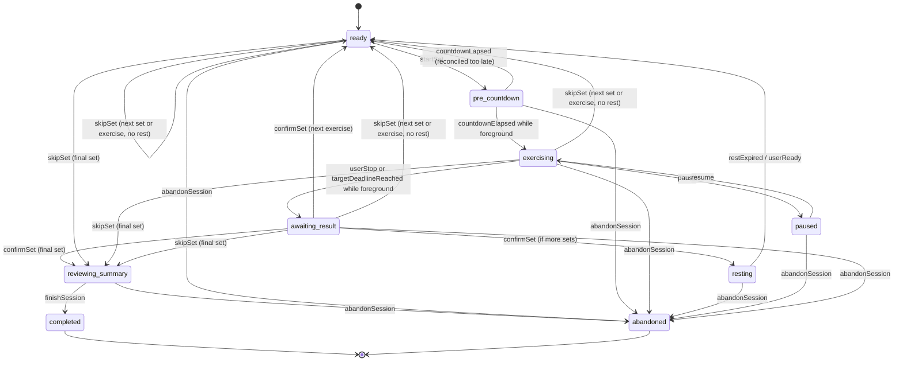

# Workout Domain + Deterministic State Machine

## 1. Bounded contexts
- **Catalog**: definition of exercise, equipment, cues, progression relationships, media; immutable-by-version snapshots.
- **Planning**: repeatable plan/workout templates, target prescriptions.
- **Execution**: actual workout sessions, exercises and sets, timer phases.
- **Journal**: actual results, note, RPE, subjective pain flag.
- **Sync**: mutations and server change feed.
- **Coaching**: deterministic stats + AI suggestions requiring approval.

## 2. Domain objects
- `TrainingPlan(id, lineageId, title, revision, parentPlanId?, status, kind, eventDate?, eventName?, primaryDiscipline, endedAt?, endReason?, endNote?, archivedAt?, startDate, weeks)`. Từ CON-003 `status` là trạng thái **phiên bản** (`current|superseded`); `lineageId` gom các phiên bản của cùng một giáo án (§2.2).
- `PlanActivation(id, planLineageId, fromDate, toDate?, timezone, endReason?, version)` (CON-003): một khoảng ngày người dùng theo giáo án.
- `PlannedWorkout(id, planId, weekday, ordering, exercises[])`.
- `PlannedExercise(id, exerciseId, order, setCount, target{holdSeconds?|repMin?|repMax?|timeSeconds?|distanceMeters?|durationSeconds?}, restSeconds, cuesSnapshot)`.
- `WorkoutSession(id, planRevisionId?, plannedWorkoutId?, localDay, startedAtUtc, finishedAtUtc?, status, currentExecutionId?, phase, phaseDeadlineUtc?, revision)`. The final confirmed set leads to `REVIEWING_SUMMARY` while `status=active`; only explicit FinishSession sets completed status.
- `ExerciseExecution(id, sessionId, plannedExerciseId?, exerciseCatalogId, sequence, setCount)`.
- `SetResult(id, executionId, setIndex, prescribedSnapshot, actualReps?, actualHoldMs?, actualWorkMs?, actualRestMs?, distanceMeters?, durationSeconds?, source, rpe?, status, confirmedAtUtc, revision)`. `distanceMeters`, `durationSeconds`, `source` thêm ở CON-004 (§3.1).
- `WorkoutNote(id, sessionId, text, createdAt, revision)`.

### 2.2 Giáo án: lineage, phiên bản và activation (CON-003, docs/19 §4)
- **Lineage** = một giáo án người dùng thấy (ADR-036). Mỗi lần Lưu hoặc áp dụng đề xuất AI tạo một **phiên bản** mới (`parentPlanId`, `revision+1`) cùng `lineageId`; phiên bản gốc có `lineageId = id`. Mỗi lineage có đúng một phiên bản chưa xoá ở trạng thái `current`, các bản cũ là `superseded`.
- **Trạng thái người dùng thấy là giá trị tính ra, không lưu** (docs/19 §4.2): nháp, đã lên lịch, đang theo, tạm dừng, đã hoàn thành, đã dừng, lưu trữ được suy từ activation, `endedAt`/`endReason` và `archivedAt` của phiên bản hiện hành. `kind=event` bắt buộc có `eventDate` (ADR-035); `primaryDiscipline` ∈ `calisthenics|running|gym|mixed`; `endNote` ≤ 500 ký tự (docs/19 §4.3).
- **Activation** gắn với lineage, không gắn với phiên bản, nên sửa giáo án không ngắt khoảng đang theo. Ngày là ngày địa phương kèm `timezone` (BR-1); `toDate` tính cả ngày đó, `null` = chưa kết thúc. Lệnh tạm dừng, hoàn thành, dừng, xoá đóng activation đang mở bằng `toDate` + `endReason` (`paused|completed|stopped|deleted`); tiếp tục mở activation mới. Lưu trữ không đóng activation.
- **I1**: các activation của một lineage không chồng lấn. **I2**: mỗi ngày có tối đa `active_plan_limit` (mặc định 3, cài đặt phía server) lineage được theo; chỉ tính lineage có phiên bản hiện hành chưa xoá và chưa kết thúc. Vi phạm bị từ chối với `active_plan_limit` (BR-2), không bao giờ tự sửa ngày.
- **Ràng buộc khi tạo** (ADR-041): `fromDate` không ở quá khứ so với ngày địa phương của `clientChangedAt` theo `timezone` (cho phép hôm nay); tối đa `plan_count_limit` (mặc định 50) phiên bản giáo án chưa xoá mỗi người dùng (BR-8, mã `plan_count_limit`). Xoá là xoá mềm (ADR-040) và không bao giờ xoá buổi tập đã ghi (I3).
- Logic chuyển trạng thái trong CaliDomain thuộc IOS-011; slice này chỉ có contract, SQL và vector.

### 2.3 Mục tiêu, giai đoạn và chỉ số (CON-005, docs/18 §6)
- `PlanGoal(id, planLineageId, title, indicatorId, exerciseId?, baseline?, target{value}|{min,max}, scopePhaseId?, unlockAfterGoalId?, status, achievedAt?, pinned, note?, version)`: nhiều mục tiêu nhỏ cho một giáo án, thay cho `training_plan.goal` đơn. Mục tiêu gắn với **lineage** nên không bị chép khi tạo phiên bản mới (docs/19 §4). `scopePhaseId = null` nghĩa là phạm vi cả giáo án.
- `current` luôn **tính trên máy** từ set đã lưu theo `aggregation` của chỉ số (`max` hoặc `sum`), không bao giờ lưu hay gửi lên. `baseline` là ảnh chụp của client lúc tạo (ADR-044).
- Trạng thái `active → reached → achieved`, cùng `missed` và `archived`. `reached` là gợi ý khi `current` chạm `target`. **`achieved` luôn do người dùng xác nhận** và mang `achievedAt` là lúc bấm; server và CaliDomain không bao giờ tự đặt `achieved` (AGENTS quy tắc 3, 5). Mục tiêu đã `archived` giữ `achievedAt` nếu có; các trạng thái khác không có `achievedAt`. Khi giáo án kết thúc, client chuyển mục tiêu `active` thành `missed` (ADR-053).
- `unlockAfterGoalId` tạo chuỗi mở khoá trong cùng lineage, không được tạo vòng (mã `goal_unlock_cycle`). Tối đa `pinned_goal_limit` (mặc định 3, ADR-048) mục tiêu ghim chưa xoá mỗi lineage (mã `pinned_goal_limit`).
- `indicatorId` và `exerciseId` không đổi sau khi tạo (ADR-047, đề xuất ADR-057): muốn đổi thì lưu trữ mục tiêu cũ và tạo mục tiêu mới. Bài tập phải có loại đo nằm trong `measurementTypes` của chỉ số.
- `PlanPhase(id, planId, orderIndex, name, weeks 1..52, description?, version)`: giai đoạn thuộc **một phiên bản** giáo án. Nhãn "Tuần a-b" và trạng thái xong / đang / sắp tới được tính, không lưu. Phiên bản mới nhận id giai đoạn mới; client trỏ lại `scopePhaseId` của mục tiêu (đề xuất ADR-057). Giai đoạn đã xoá thì mục tiêu hiển thị như phạm vi cả giáo án.
- `IndicatorDefinition(id, version, kind, label, unit, step, aggregation, measurementTypes[], enabled)`: danh mục do server/portal sở hữu (ADR-051), client chỉ đọc. `kind` ∈ `performance|adherence|volume|milestone|body`. Mọi thay đổi mục tiêu và giai đoạn đều được ghi audit (đề xuất ADR-059).

**MVP scope (ADR-017).** These fields above are *post-MVP* and are **not** in the MVP contracts: `TrainingPlan.startDate/weeks`, `WorkoutSession.planRevisionId/revision`, `WorkoutNote.revision`, `PlannedExercise.cuesSnapshot`. `ExerciseExecution.setCount` is carried as `prescribedSnapshot.setCount` (ADR-018). The MVP adds these journal fields: `SetResult.skipReason` (≤500), `SetResult.painReported` (subjective pain flag, default false) and `SetResult.note` (≤1000). It adds these pause/abandon fields: `WorkoutSession.pausedAt`, `accumulatedExerciseMs` and `abandonReason` (≤500). `finishedAt` is set for both completed and abandoned sessions.

### 2.1 Concept → wire name mapping (ADR-016)
This section describes the conceptual model. **Wire names are canonical**: OpenAPI and JSON Schema use camelCase, and `db/001_initial.sql` uses snake_case.

| Concept (this doc) | Wire (OpenAPI / JSON Schema) | SQL |
|---|---|---|
| `localDay` | `localDate` | `local_date` |
| `startedAtUtc` / `finishedAtUtc` | `startedAt` / `finishedAt` (also set on abandon) | `started_at` / `finished_at` |
| `phaseDeadlineUtc` | `phaseDeadlineAt` | `phase_deadline_at` |
| `confirmedAtUtc` | `confirmedAt` | `confirmed_at` |
| `exerciseCatalogId`, `exerciseId` | `exerciseId` | `exercise_id` |
| `ordering`, `order`, `sequence` | `orderIndex` | `order_index` |
| `WorkoutNote.text` | `noteText` | `note_text` |
| `accumulatedElapsed` | `accumulatedExerciseMs` | `accumulated_exercise_ms` |
| `reason` of AbandonSession / SkipSet | `abandonReason` / `skipReason` | `abandon_reason` / `skip_reason` |
| phases `READY`, `PRE_COUNTDOWN`, `REST`, `REVIEWING_SUMMARY`, `COMPLETE`… | `ready`, `pre_countdown`, `resting`, `reviewing_summary`, `completed`… | same as wire |

## 3. Exercise type + validation
| Type | Planned input | Actual output | Guard |
|---|---|---|---|
| STATIC_HOLD | holdSeconds >0, setCount >0 | actualHoldMs >=0 | no rep as primary |
| REPS | rep target min/max >0, repMin ≤ repMax (ADR-020) | actualReps >=0 integer | no auto rep sensor |
| TIMED_REPS | timeSeconds >0 | actualReps >=0, actualWorkMs >=0 | manual count |
| INTERVAL | workSeconds ≥1, restSeconds ≥1 (ADR-019; zero-rest work = TIMED_REPS) | actualWorkMs and optional reps | no auto success |
| SKILL_ATTEMPT | number of attempts | success/fail + optional hold | quality subjective |
| DISTANCE (CON-004) | distanceMeters 1..500000, durationSeconds 1..86400 tuỳ chọn (thời gian mục tiêu) | completed: distanceMeters >0 **và** durationSeconds >0 | pace chỉ tính ra, không lưu |
| DURATION (CON-004) | durationSeconds 1..86400 | completed: durationSeconds >0; distanceMeters tuỳ chọn | nhập tay (`source=manual`) |

`target.kind` must equal the catalog exercise type. JSON Schema cannot express this check or `repMin ≤ repMax`, so the backend and CaliDomain enforce both. Shared test vectors live in `fixtures/validation/business_rules.json` (ADR-020).

### 3.1 Chạy bộ (CON-004, docs/19 §4.1)
- Môn `running` dùng hai loại bài mới `distance` và `duration`. Cùng một tập giá trị phải có ở `ExerciseType` (OpenAPI), `$defs.target` (entity schema) và `item.type` (catalog bundle); `tools/validate_handoff.py` và `PayloadContractTests` kiểm tra ba nơi không lệch nhau. `Discipline` (`calisthenics|gym|running`) và `MeasurementType` (`hold|reps|distance|duration`) mới được định nghĩa trong OpenAPI; trường dùng chúng ở giáo án và bài tập do CON-006 thêm.
- **Một set = một chặng.** Ví dụ chạy biến tốc 3 × 5 phút, nghỉ 2 phút: `setCount=3`, `target={kind:duration, durationSeconds:300}`, `restSeconds=120`. Nghỉ giữa chặng vẫn dùng `restSeconds`, không có loại mục tiêu riêng.
- Kết quả lưu `distanceMeters` (số nguyên, mét) và `durationSeconds` (số nguyên, giây). UI hiển thị km với 2 chữ số thập phân và pace phút/km (ADR-055); thời gian dạng h:mm:ss, quá 24 giờ (86400 s) bị từ chối (IOS-014).
- **Pace luôn là giá trị tính ra** = `durationSeconds / (distanceMeters / 1000)`, không bao giờ nằm trong payload hay cột SQL. Payload có trường pace bị từ chối vì object đóng (ADR-030); vector ở `fixtures/validation/schema_rejections.json`.
- `source` chỉ nhận `manual`. `healthkit` được giữ chỗ cho slice Apple Health sau pilot (ADR-043) và hiện bị từ chối ở cả JSON Schema lẫn CHECK SQL. Trường này không bắt buộc trên wire nên payload v1 vẫn hợp lệ; server ghi mặc định `manual`.
- Quy tắc chéo trường (backend + CaliDomain, ADR-020; vector ở `fixtures/validation/business_rules.json`): `distanceMeters`/`durationSeconds` chỉ được có khi `prescribedSnapshot.target.kind` là `distance` hoặc `duration`; set `completed` loại distance cần cả hai giá trị >0 để tính được pace; set `completed` loại duration cần `durationSeconds` >0.
- Logic CaliDomain cho các loại này thuộc IOS-011, không nằm trong slice contract này.

Superset design can reuse grouped planned exercises later; MVP executes linear sequence.

## 4. Persistent state machine

The diagram matches the transition table below (ADR-029). AbandonSession is accepted from every non-terminal phase. A skipped set earns no rest.

**Important distinction:** `countdownElapsed` / `restExpired` may be computed when foreground resumes; background suspension does **not** guarantee callback. Domain state on disk remains stable until reconciliation is called. `restExpired → ready` only updates readiness, never starts exercising.

### Transition table
| Command/event | Precondition | Transactional write | Side effect after commit |
|---|---|---|---|
| `CreateSession(cmdId)` | no active session | insert session READY + outbox | start/resume screen |
| `StartSet(cmdId)` | READY, set is not confirmed | phase PRE_COUNTDOWN, start/deadline | update Live Activity |
| `CountdownElapsed` | PRE_COUNTDOWN & app executing | phase EXERCISING; compute UTC target | schedule deadline notification |
| `Pause(cmdId)` | EXERCISING | pausedAt, accumulatedExerciseMs; phase PAUSED | update Activity, cancel/rebuild notifications |
| `Resume(cmdId)` | PAUSED | recompute deadline; EXERCISING | update Activity/notification |
| `StopSet(cmdId)` | EXERCISING or elapsed deadline reconciled | AWAITING_RESULT draft | prompt actual values |
| `ConfirmSet(cmdId, payload)` | AWAITING_RESULT; unique set not confirmed | insert `set_result` + advance phase REST/READY/REVIEWING_SUMMARY + outbox | Activity and next notification |
| `ExtendRest(cmdId, +30s)` | RESTING | recompute deadline, revision | cancel previous reminder, schedule new one |
| `ReadyNext(cmdId)` | RESTING, manual request or deadline reached | READY | Activity refresh |
| `SkipSet(cmdId, reason)` | READY/EXERCISING/AWAITING_RESULT | set_result SKIPPED + skipReason, revision, phase next READY (no rest) or REVIEWING_SUMMARY | Activity |
| `FinishSession(cmdId)` | REVIEWING_SUMMARY, no active set pending confirmation | COMPLETED + finishedAt + outbox | end Activity; AI after sync |
| `AbandonSession(cmdId)` | active session (any non-terminal phase) | ABANDONED, abandonReason, finishedAt | end Activity |

### Universal domain invariants
- Exactly one authoritative `WorkoutSession` state per session ID; accepted commands have unique `command_id` across all entrypoints.
- Exactly one active pending set for `(executionId,setIndex)`; duplicates return prior result, never increment counters.
- Never infer `COMPLETE` from timer deadline alone; timer is a prompt, not proof of rep/hold.
- Every `ConfirmedSet` snapshots prescribed target, actual metrics and catalog version.
- `phaseDeadlineUtc` persisted in same transaction as state revision; iOS may render countdown without per-second writes.
- `status=completed ⇔ phase=completed` and `status=abandoned ⇔ phase=abandoned`; `pausedAt` is non-null only in PAUSED. This is ADR-023, also enforced by SQL CHECK and JSON Schema.
- `PAUSED` has no active moving deadline. Recompute remaining duration on resume, rather than adding timers.
- `RESTING` never auto-triggers a new exercising set without user Start action.
- On edit set result, increment revision and write a mutation; downstream analysis of old revision is superseded.
- User initiated explicit skip/abandon always takes precedence over notifications.

## 5. Timer calculation
- Use monotonic uptime while foreground for elapsed durations; persist anchor UTC, remaining milliseconds and recorded elapsed on pause/resume.
- When process returns from background after kill/suspension, compute due/overdue using wall-clock UTC anchor and inspect for large device clock jump. Do **not** invent accurate hold duration if user may have stopped physically while screen locked: ask for actual held seconds.
- For static hold in background: deadline still renderable via ActivityKit; notify at target, but actual hold must be confirmed, with editable value.
- For reps: no automatic rep detection; decrement/rep counter only while user presses controls; final actual rep is confirmed in result form.
- Notifications schedule **only current phase** plus optional 10s warning to limit pending items. After new rest duration, revoke old IDs and schedule new IDs; duplicate delivered notifications may be ignored by command version.

## 6. Pseudocode — command processing
```text
handle(command):
  BEGIN IMMEDIATE TRANSACTION
  if command.id alreadyProcessed: return savedResult
  session = loadCurrentSessionForUpdate()
  validateAllowedTransition(session.phase, command)
  (nextState, domainEvents) = reducer(session, command)
  save(nextState, expectedRevision=session.revision)
  saveDomainWrites(domainEvents)   # set results, notes, revisions
  appendOutboxMutation(domainEvents) # atomic with business writes
  recordProcessedCommand(command.id, response)
  COMMIT
  publishLocalState(nextState)
  rescheduleLocalNotifications(nextState)
  updateLiveActivity(nextState)
  trySyncBestEffort()
```
For a widget extension, use shared App Group DB or a clearly serialized IPC strategy; avoid concurrent unsynchronized writes from host and extension.

## 7. Edge cases to test
1. User taps Complete two times quickly → 1 row, 1 count.
2. App killed after confirming set, before Sync → row + outbox persisted.
3. iPhone lock during 12s hold → deadline can render; no invented completed set.
4. Phone clock changes during rest → report adjustment/reconcile, never modify confirmed metrics.
5. Rest +30s repeated while widget and app active → revision and deadline consistent.
6. Outbox failed retry → no duplicate set server-side.
7. Session restored when app is launched after 24h → prompt resume/finish/abandon; no silently ongoing workout.
8. Permissions denied for notification/live activity → app still functional foreground.
