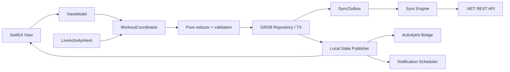

# iOS Architecture — SwiftUI / Offline-first

## 1. Baseline
- Target **iOS 18+** (assumption; revise ADR if audience needs iOS 17); Swift 6 concurrency checks where toolchain supports.
- Xcode latest stable for team's selected macOS, SwiftUI, WidgetKit/ActivityKit, App Intents, UserNotifications, AVKit, GRDB + SQLite, URLSession, Network framework.
- Native feature-first modules; MVVM/Observable state in UI layer, domain reducer pure/testable, repositories for persistence.
- App is fully usable as guest; Sign in with Apple unlocks remote sync.

## 2. Proposed source structure
```text
ios/
  CaliApp/
    App/CaliApp.swift
    Features/Home/
    Features/Planner/
    Features/Catalog/
    Features/WorkoutPlayer/
    Features/Journal/
    Features/AIReview/
    Features/Settings/
    DesignSystem/
  CaliCore/
    Domain/WorkoutReducer.swift
    Domain/Commands.swift
    Data/Database.swift
    Data/Repositories/
    Sync/OutboxSyncEngine.swift
    Services/WorkoutCoordinator.swift
    Services/NotificationScheduler.swift
    Services/MediaCache.swift
    Services/LiveActivityBridge.swift
    Services/SessionReconciler.swift
    Networking/APIClient.swift
    Security/TokenVault.swift
  CaliActivityWidget/
    WorkoutAttributes.swift
    LiveActivityViews.swift
    IntentHandlers.swift
  CaliAppTests/
  CaliCoreTests/
  CaliActivityTests/
```

## 3. Local persistence
Use GRDB over SQLite to make schema/versioning, atomic transactions and outbox explicit. App Group container for host app + widget extension. Store media in Application Support with an indexed cache DB; only share tiny poster file if widget needs it. Keychain for tokens, not SQLite. Use iOS Data Protection appropriate for extensions and locked access; validate file availability in lock-state POC, do not assume `completeFileProtection` permits needed extension reads while locked.

Main tables mirror server business entities plus `processed_commands(command_id PK,response_json)`, `sync_outbox(seq PK, mutation_id UNIQUE, entity_type, entity_id, action, base_version, json, state, attempts, created_at, last_error)`, `sync_cursor(user_id, cursor)`, `media_cache`, `local_session_state`.

**Implemented (IOS-001, ADR-074).** `ios/Packages/CaliCore` owns the database `Application Support/cali.sqlite` (WAL `DatabasePool`, foreign keys on). The app process is the only writer (ADR-013); the widget extension never opens it.
- Migration `v1` (POC-002): `local_session_state`, `set_results`, `sync_outbox`, `processed_commands`.
- Migration `v2_content`:
  - Plan tables per CON-003: `training_plans`, `plan_activations`, `planned_workouts`, `planned_exercises`, each with `server_version` and `dirty`.
  - `exercises`, `session_history`, `recommendations`, `audit_log` (id = commandId), `app_settings`, `sync_cursor`, `media_cache`, `legacy_imports`.
  - A `title` column on `local_session_state`.
- Writers:
  - `WorkoutCoordinator` handles workout commands. A session's terminal transition also writes its `session_history` row in the same transaction.
  - `ContentStore` handles catalog, plan, AI decision and settings edits. Each edit is one `BEGIN IMMEDIATE` transaction with its audit row, deduplicated on the commandId.
- Legacy import: `LegacySnapshotImporter` moves the pre-IOS-001 `cali-poc.json` into the database once, then renames the file to `cali-poc.imported.json`. An unreadable file is moved aside and nothing is written.
- Sync: content edits only set `dirty` for now. Enqueuing them in `sync_outbox` is `TODO(IOS-007)`.

## 4. Data flow


## 5. Sync scheduling (best effort)
Triggers: app foreground, after local mutation, network path available, BGAppRefreshTask when system grants runtime, pull-to-refresh. `NWPathMonitor` reports path availability but not server reachability; verify API with request. Retry exponential backoff + jitter and honor server 429 retry-after. Background sync is **not** instantaneous or guaranteed; UI indicates pending mutations.

## 6. Media
- Bundled starter posters for essential exercises; fetched media files with checksum, version, license metadata.
- Download videos on Wi-Fi by default with user override; use URLSession background configuration for downloads, AVPlayer for playback.
- Cache index tracks state `NOT_PRESENT / DOWNLOADING / READY / FAILED`, bytes, SHA-256, lastAccessed, pinnedUntil.
- Pin media for today/next workout; never evict pinned media while active session; fallback to poster + technique cues.
- Voice pack (CON-010, ADR-077/078): fetched after catalog refresh with `If-None-Match`; each cue downloaded once, sha256-verified and copied to `Library/Sounds/cali-voice-{locale}-v{version}-{key}.caf` (the only folder `UNNotificationSound(named:)` reads); the previous version is kept until the new one is complete, then removed. `VoiceCueService` sits beside `NotificationService` in `SideEffects`: in foreground it plays the file, otherwise the cue rides on the scheduled notification. Due times come from `VoiceCuePlan` (CaliCore, pure, from the persisted deadlines); the deadline cue is the sound of the existing deadline reminder, the halfway / 10 s cues get their own requests (`cali.voice.{key}`), all replaced on every accepted transition. Setting `voiceCuesEnabled` (default on).

## 7. Dependency direction
`Features -> Application services -> Domain protocols <- Data/Infra`. Domain reducer must not import SwiftUI, WidgetKit, URLSession or LLM. Use dependency injection to allow a fake clock, mock notification scheduler, fake repository.

## 8. Recovery behavior
- On scene become active: load local durable session; reconcile deadline; query Activity status; refresh notification schedule.
- On app crash/relaunch: durable journal and outbox are source of truth; stale Widget state must be reconciled.
- Logout: ask whether to keep local data; never silently wipe prior guest workouts.
- Local media cache can be rebuilt without losing workout history.

## 9. Build/test requirements
- Unit tests for reducer + fake time, GRDB migrations and transactions, idempotent command processing, caches, sync.
- UITests for large font/device rotation/small screens; device manual tests for lock+background.
- Widget previews for all phases and Dynamic Island variants; screen capture baseline/golden images optional.
