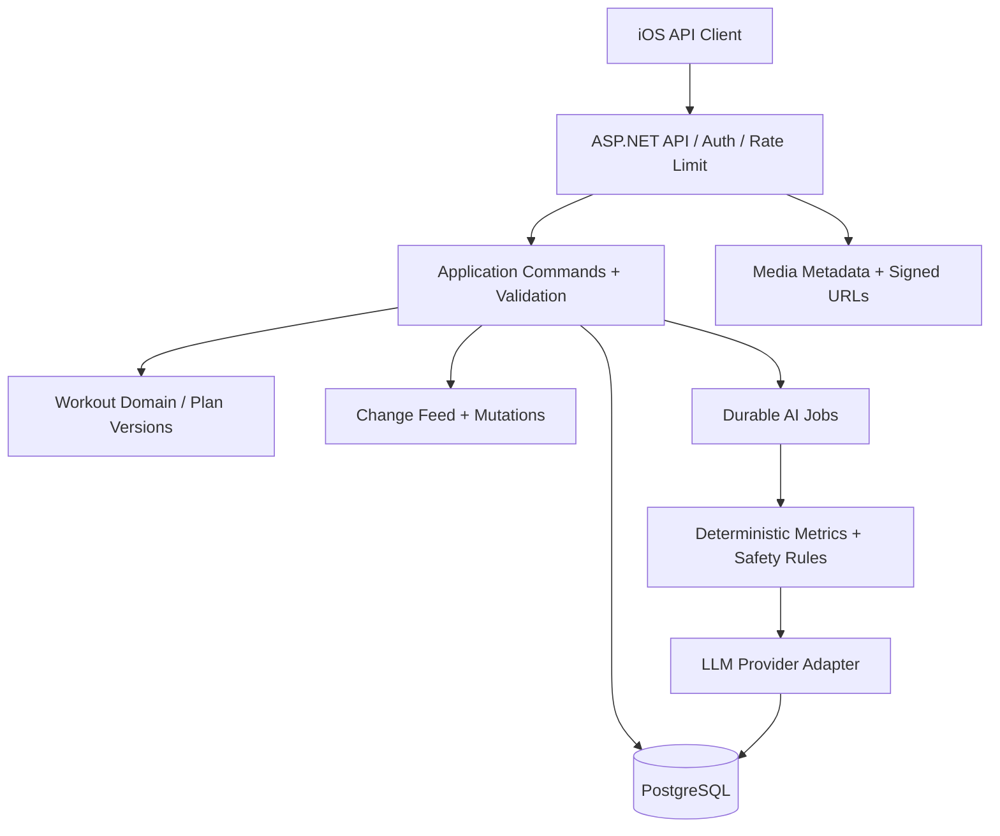

# Backend Architecture — ASP.NET Core 10 / PostgreSQL

## 1. Technology and deployable units
- ASP.NET Core .NET 10 LTS, EF Core 10 or Npgsql+Dapper for critical sync paths; PostgreSQL 16+ as baseline (pin deployment version), OpenAPI 3.1.
- Modular monolith first, split only with evidence. Modules: Identity, Catalog, Plans, Sessions, Sync, Coaching, Media.
- Background worker for AI analysis and retry jobs; initially Postgres-backed durable queue/`ai_jobs`, avoid RabbitMQ until operational need warrants it.
- Binary media: object storage + CDN or private static bucket; DB stores metadata, signed URLs; do **not** store MP4 blobs in PostgreSQL.
- Auth: guest local; after Sign in with Apple, backend verifies ID token/nonce securely, maps stable Apple user identifier to internal UUID, issues app access/refresh tokens.

## 2. Layering

## 3. APIs baseline
| Area | Route | Description |
|---|---|---|
| Identity | `POST /v1/auth/apple` | exchange Apple identity token for app session |
| Identity | `POST /v1/auth/refresh` | rotate refresh token |
| Identity | `GET /v1/me` | current profile |
| Catalog | `GET /v1/exercises` | filter + cursor pagination + media refs |
| Catalog | `GET /v1/exercises/{id}` | details/version/cues |
| Plan | `GET /v1/plans` | available plan revisions |
| Plan | `POST /v1/plans` | server plan create for signed in user (optional if syncing only) |
| Sync | `POST /v1/sync/push` | idempotent mutation batch |
| Sync | `GET /v1/sync/pull?cursor=&limit=` | ordered user changes, opaque cursor |
| AI | `POST /v1/analyses` | enqueue analysis keyed by session + revision |
| AI | `GET /v1/analyses/{id}` | poll job status and structured result |
| AI | `POST /v1/recommendations/{id}/decision` | accept/reject with optimistic version |

`contracts/openapi.yaml` is wire truth. Direct create endpoints and Sync mutations must share validation, auth and concurrency rules. Sync is canonical offline-first write path.

## 4. API conventions
- All write requests idempotent by stable client `mutationId` or `Idempotency-Key`; retry returns same result.
- UUID v4 IDs created on device; server assigns `version` bigint and `change_seq` monotonically increasing per user's feed.
- UTC timestamps RFC3339; `localDate` and IANA `timezone` separate fields for planning and reporting.
- Pagination: `limit` bounded to 100; opaque cursors; no offset pagination in mutable change feed.
- Errors: `application/problem+json` with stable `code`, `traceId`, `details` (no secrets).
- Auth scopes user data by authenticated `user_id`; never accept `userId` from client as authorization.
- Rate limits for auth, sync, AI; retries exposed via 429/Retry-After.

## 5. Workflow AI async
`Session completed local → synced to server → requested analysis job → PENDING → worker validates complete input → deterministic metrics and safety flags → prompt LLM schema restricted → validate JSON, retry bounded → AVAILABLE or FAILED → append analysis change to sync feed → app sees result`.
Analyses keyed by `(session_id, session_revision, algorithm_version)` to prevent redundant charge. If session edited, mark older analysis superseded and optionally enqueue new analysis.

## 6. Storage consistency
- In one PostgreSQL transaction apply accepted mutation, record receipt in `sync_mutations`, increment entity version and append `change_log` (for pull).
- Validation failures are per operation; do not partially write individual operation.
- Unique `(user_id, mutation_id)` across retries, stable receipt replays; dedupe retention policy must exceed maximum offline retry horizon (recommend permanent or durable per user until account deletion).
- Conflict returns server latest entity/version; no hidden overwrites.
- Soft delete with tombstones pushed through feed; retain > max supported device offline horizon (initial policy 180 days, configurable and documented).

## 7. Deployment/ops
- One API container, one Worker container, one PostgreSQL; shared migrations; object storage/CDN.
- Readiness probes verify DB health; liveness is local lightweight; graceful shutdown/worker lease.
- CI: lint, unit/integration tests, migrate disposable Postgres, OpenAPI contract validation, vulnerability scan.
- Configuration via secrets manager/environment; never send LLM API key to iOS.
