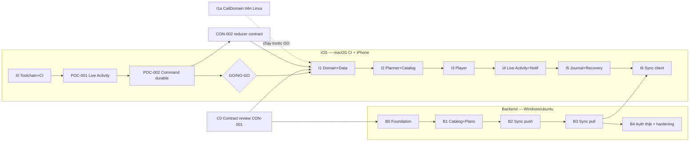

# Implementation Plan — iOS App + Backend (zero-cost dev setup)

**Phiên bản:** v0.1 (2026-11-07) · **Trạng thái:** đề xuất, chờ chủ dự án duyệt
**Phạm vi:** chi tiết hóa M0 → M2 trong [`13-delivery-backlog.md`](13-delivery-backlog.md) cho iOS app và backend. AI Coach (M3) chỉ nêu điểm nối.
Tài liệu này **không thay thế** ADR/contract. Nếu mâu thuẫn, ưu tiên theo quy tắc trong README.

---

## 1. Ràng buộc môi trường

| Hạng mục | Hiện có | Hệ quả |
|---|---|---|
| Máy dev | Windows 11, .NET SDK 10, Docker Desktop (WSL2), Python 3.13 | Backend, contract, Swift domain (qua Docker) làm local được |
| Mac | **Không có** | Không có Xcode/Simulator local; build iOS chỉ qua **GitHub Actions macOS runner** |
| iPhone | Có (cần iOS 18+ theo ADR-010) | Thiết bị test thật duy nhất |
| Apple account | **Apple ID miễn phí** (Personal Team) | Cài app qua **Sideloadly**, hết hạn 7 ngày; không có Sign in with Apple, Push, TestFlight; **App Groups nhiều khả năng không có** (phải kiểm chứng ở POC) |
| GitHub | Repo **private**, GitHub Free | ~2.000 phút/tháng, macOS tính hệ số 10 ⇒ **~200 phút macOS/tháng**. Ubuntu runner rẻ hơn 10 lần |

### 1.1 Nguyên tắc tiết kiệm phút macOS
- Mọi thứ chạy được trên Linux thì **chạy trên ubuntu runner**: backend, contract tests, `CaliDomain` Swift package (image `swift:6.2-noble`).
- Workflow macOS chỉ chạy khi: `workflow_dispatch` thủ công, PR có label `ios-build`, hoặc push lên `main` có thay đổi trong `ios/**`.
- Dùng `paths:` filter + `concurrency: cancel-in-progress` + cache SwiftPM (`~/Library/Caches/org.swift.swiftpm`, `.build`).
- Đo thời gian mỗi job macOS, ghi vào bảng ở §8 để theo dõi ngân sách (không ước lượng trước).

### 1.2 Vòng lặp test trên iPhone (không có Mac)
```text
push / workflow_dispatch
  → ios-build.yml (macos runner): xcodegen generate → xcodebuild archive CODE_SIGNING_ALLOWED=NO
  → đóng gói Payload/CaliApp.app → CaliApp-unsigned.ipa → upload artifact
Windows: tải artifact → Sideloadly (Apple ID free) ký + cài qua USB → iPhone (Developer Mode bật)
```
- Không debug trực tiếp ⇒ app phải có **Diagnostics screen** (dev build): đọc `OSLogStore(scope: .currentProcessIdentifier)`, xem DB state, outbox, notification đang pending, Activity hiện tại; nút **Export** (share sheet → file .json/.txt).
- Bằng chứng device test: screen recording của iOS + export diagnostics, lưu vào `evidence/<task-id>/`.

### 1.3 Gọi backend từ iPhone khi dev
- Backend chạy Docker trên Windows; mở HTTPS miễn phí bằng **Cloudflare quick tunnel** (`cloudflared tunnel --url http://localhost:8080`) ⇒ không cần ATS exception.
- Base URL cấu hình qua Diagnostics screen (dev build) — không hardcode, không commit URL tunnel.

---

## 2. Cấu trúc repository đích

```text
/
├─ ios/
│  ├─ project.yml                 # XcodeGen — .xcodeproj KHÔNG commit (generate trong CI)
│  ├─ Packages/
│  │  ├─ CaliDomain/              # Swift package thuần: reducer, commands, clock, validation
│  │  │                           # chỉ Foundation; KHÔNG import SwiftUI/UIKit/GRDB/ActivityKit ⇒ test được trên Linux
│  │  └─ CaliCore/                # GRDB data, repositories, coordinator, sync, services (Apple-only)
│  ├─ CaliApp/                    # SwiftUI app target (Features/*, DesignSystem/)
│  ├─ CaliActivityWidget/         # Widget extension: Live Activity views + LiveActivityIntent
│  └─ CaliAppTests/ CaliUITests/
├─ backend/
│  ├─ Cali.sln
│  ├─ src/
│  │  ├─ Cali.Api/                # ASP.NET Core minimal APIs, auth, rate limit, ProblemDetails
│  │  ├─ Cali.Worker/             # BackgroundService: ai_jobs lease (M3), housekeeping
│  │  ├─ Cali.Application/        # use cases theo module, validation
│  │  ├─ Cali.Domain/             # entity rules, invariants (không phụ thuộc infra)
│  │  └─ Cali.Infrastructure/     # Npgsql/Dapper, migrations runner, JWKS, clock
│  ├─ tests/
│  │  ├─ Cali.UnitTests/
│  │  ├─ Cali.IntegrationTests/   # Testcontainers PostgreSQL
│  │  └─ Cali.ContractTests/      # đối chiếu openapi.yaml + entity-payloads.schema.json
│  └─ tools/Cali.DevToken/        # CLI mint JWT dev (thay Sign in with Apple khi chưa có tài khoản trả phí)
├─ db/                            # SQL migrations (nguồn sự thật schema) — giữ nguyên vị trí
├─ contracts/  docs/  fixtures/  tests/  tools/
├─ docker-compose.yml             # postgres + api (+ worker)
└─ .github/workflows/
   ├─ backend.yml                 # ubuntu: build, test, migrate-from-blank, contract
   ├─ swift-domain.yml            # ubuntu: swift test cho CaliDomain
   ├─ handoff.yml                 # ubuntu: tools/validate_handoff.py
   └─ ios-build.yml               # macos: generate, unit test, archive unsigned .ipa
```

---

## 3. Quyết định kỹ thuật đề xuất (cần duyệt → ghi ADR)

| ID đề xuất | Quyết định | Lý do | Ảnh hưởng nếu từ chối |
|---|---|---|---|
| ADR-011 | Sinh Xcode project bằng **XcodeGen** (`project.yml`), không commit `.xcodeproj` | Không có Mac; tránh conflict file pbxproj | Cần Mac để tạo/sửa project |
| ADR-012 | Tách **CaliDomain** (pure Swift, chạy Linux) khỏi **CaliCore** (GRDB/Apple) | Test reducer trên ubuntu runner/Docker local, tiết kiệm phút macOS; đúng §7 iOS architecture | Mọi test iOS tốn phút macOS |
| ADR-013 | **Single-writer = app process.** `LiveActivityIntent` (chạy trong process app) gọi cùng `WorkoutCoordinator`; widget extension **chỉ render** `ContentState`, không mở DB | Né rủi ro R-03 (race widget/app) và R-08 (Data Protection khi khóa), và chạy được khi **không có App Group** | Nếu POC-002 chứng minh cần extension đọc DB ⇒ cần App Group ⇒ cần tài khoản trả phí |
| ADR-014 | DB backend: **SQL migrations trong `db/`** chạy bằng **DbUp**; truy cập dữ liệu bằng **Dapper** (đặc biệt sync path) | `db/001_initial.sql` là contract (AGENTS §7); kiểm soát transaction/locking rõ ràng | EF Core migrations sẽ tách khỏi SQL contract |
| ADR-015 | Auth dev: **Cali.DevToken** mint JWT bằng khóa dev, chỉ được chấp nhận khi `ASPNETCORE_ENVIRONMENT=Development`; Apple validation code đầy đủ, test bằng JWKS giả | Không có Sign in with Apple khi dùng Apple ID free; không thêm endpoint ngoài OpenAPI | — |

> ADR-013 thay đổi giả định của ADR-002 ("GRDB/SQLite local **(App Group)**"). Theo quy tắc README: tạo ADR issue, cập nhật `docs/04`, `docs/05`, `docs/15` trong cùng PR **sau khi** có evidence POC.

---

## 4. Lộ trình tổng thể và song song hóa



| Bước | Có thể làm ngay trên Windows | Cần macOS CI | Cần iPhone |
|---|---|---|---|
| C0, B0–B4 | ✅ | — | chỉ khi E2E |
| I0, POC-001/002 | soạn code | ✅ build | ✅ |
| I1a CaliDomain | ✅ (Docker `swift`) | — | — |
| I1–I6 | soạn code + domain test | ✅ | ✅ cho device matrix |

**Thứ tự PR đề xuất** (mỗi PR là 1 vertical slice nhỏ, có test evidence):
1. `C0` contract review + CI handoff → 2. `B0` backend foundation → 3. `I0` iOS toolchain → 4. `POC-001` → 5. `B1` → 6. `POC-002` + GO/NO-GO report → 7. `CON-002` + `I1a` → 8. `B2` → 9. `I1`… tiếp tục xen kẽ hai track.

---

## 5. Kế hoạch chi tiết — Contract & nền tảng (M0)

### C0 — PO-001 + CON-001: Review contract (Windows)
**Việc:**
- Chạy `tools/validate_handoff.py` với PyYAML + jsonschema; thêm `handoff.yml` CI.
- Đối chiếu chéo 4 nguồn: `openapi.yaml` ⇄ `entity-payloads.schema.json` ⇄ `db/001_initial.sql` ⇄ `docs/03`/`docs/07`: tên field (camelCase wire ↔ snake_case DB), enum `phase`/`status`/`set status`, kiểu thời gian (UTC RFC3339, `localDate`, IANA `timezone`), giới hạn (`set_count 1..20`, `rest 0..3600`, `rpe 1..10`).
- Apply `db/001_initial.sql` + `002` lên Postgres 16 thật (Docker) — xác nhận DDL chạy được.
- Ghi danh sách mâu thuẫn → sửa đồng bộ hoặc mở ADR issue.

**DoD:** validate script pass trong CI; DDL migrate từ DB trống thành công; báo cáo `docs/` hoặc PR description liệt kê mapping + quyết định.

### I0 — iOS toolchain & CI (macOS CI)
**Việc:**
- `ios/project.yml`: targets `CaliApp` (iOS 18), `CaliActivityWidget` (widget extension), `CaliAppTests`; `NSSupportsLiveActivities = YES`; bundle ID dạng `com.<owner>.cali.dev` cấu hình qua xcconfig (không hardcode Team ID).
- `ios-build.yml`: `macos-15` runner, chọn Xcode bằng `xcode-select`, `brew install xcodegen`, `xcodegen generate`, `xcodebuild -scheme CaliApp -sdk iphoneos -configuration Debug archive CODE_SIGNING_ALLOWED=NO`, đóng gói `.ipa`, upload artifact (retention 7 ngày).
- Job test riêng (tùy chọn, tốn phút): `xcodebuild test -destination 'platform=iOS Simulator,name=iPhone 16'`.
- Hướng dẫn `ios/README.md`: cài Sideloadly, bật Developer Mode, tin cậy chứng chỉ, giới hạn 7 ngày/3 app.

**DoD:** artifact `.ipa` tải về cài được lên iPhone bằng Sideloadly, app mở được (màn hình "Hello CALI" + build SHA).
**Rủi ro:** Sideloadly ký widget extension bằng free account có thể lỗi ⇒ ghi lại; fallback: thử AltStore hoặc tạm cài app không có extension để tiếp tục POC phần app.

### POC-001 — Live Activity countdown + hành vi khi khóa (iPhone)
Theo [`05-lock-screen-poc.md`](05-lock-screen-poc.md) §4 bước 2–4, 6.
**Việc:**
- Màn hình POC: nút "Start hold 12s", "Start rest 90s", "+30s", "End".
- `WorkoutAttributes` + `ContentState` đúng danh sách field §2 của doc 05; view Lock Screen + Dynamic Island dùng `Text(timerInterval:pauseTime:countsDown:)`.
- Một nút `LiveActivityIntent` (`+30s`) — log `os_log` kèm `UIApplication.protectedDataAvailable`, thời điểm, trạng thái khóa.
- Local notification tại deadline hold và cảnh báo rest còn 10s.
- Diagnostics screen v0 (đọc OSLogStore + export).

**Test thủ công (ghi evidence):** auto-lock 30s; tắt màn hình; airplane mode; tap nút khi **đang khóa** vs **sau Face ID**; notification bị từ chối; Focus/Silent.
**DoD:** bảng kết quả + video vào `evidence/POC-001/`; xác nhận App Groups có/không khả dụng với free account.

### POC-002 — Command durable + single-writer (iPhone)
**Việc:**
- GRDB DB trong container app (không App Group); bảng tối thiểu `local_session_state`, `processed_commands`, `sync_outbox`, `set_results`.
- `WorkoutCoordinator.handle(command)` theo pseudocode doc 03 §6 (`BEGIN IMMEDIATE`, dedupe `command_id`, ghi outbox cùng transaction).
- `LiveActivityIntent` gọi **cùng** coordinator (ADR-013). Kiểm tra intent chạy được khi app bị suspend/kill.
- Test: double-tap Confirm (T-04), kill sau confirm (T-09), tap từ Activity và app đồng thời.

**DoD:** DB inspection qua Diagnostics export chứng minh 1 row/1 outbox; báo cáo **GO/NO-GO** theo doc 05 §6; nếu GO ⇒ cập nhật ADR-002/013.

### CON-002 — Reducer transition contract
- Chốt bảng transition (doc 03 §4) thành **test vectors JSON** trong `fixtures/reducer/*.json` (input state + command + clock ⇒ expected state/events/error) — dùng chung cho Swift tests và (nếu cần) backend validation.
- **DoD:** fixtures được review; CaliDomain test đọc fixtures pass.

---

## 6. Backend — kế hoạch chi tiết

Stack: ASP.NET Core **.NET 10 LTS** (minimal APIs), PostgreSQL **16** (pin `postgres:16.x`), Npgsql + Dapper, DbUp, JsonSchema.Net (validate entity payload), Microsoft.IdentityModel (JWT/JWKS), built-in RateLimiter + ProblemDetails, OpenTelemetry. Test: xUnit, Testcontainers.PostgreSql, FluentAssertions-free assertions (tránh license issue) hoặc Shouldly.

### B0 — Foundation (BE-001 phần khung)
- Solution + 5 project + 3 test project như §2; `Directory.Build.props` bật nullable, warnings-as-errors, analyzers.
- `docker-compose.yml`: postgres + api; healthcheck.
- Migration runner (DbUp) apply `db/*.sql` theo thứ tự khi khởi động (Development) và qua lệnh riêng (`dotnet run --project Cali.Api -- migrate`) cho prod.
- Cross-cutting: ProblemDetails với `code`/`traceId`; `/health/live`, `/health/ready` (ping DB); OpenTelemetry tracing; log redaction (không log body/token/notes).
- Auth khung: JWT bearer; `ICurrentUser` lấy `user_id` **chỉ từ token**; `Cali.DevToken` CLI (ADR-015).
- CI `backend.yml`: restore, build, unit, integration (Testcontainers), migrate-from-blank.
- **Tests:** migrate từ DB trống; health ready fail khi DB down; request không token → 401 problem+json.
- **DoD:** `docker compose up` → `/health/ready` 200; CI xanh.

### B1 — Catalog + Plans + Me (BE-001/BE-002)
- `GET /v1/exercises` (filter + cursor pagination, `limit ≤ 100`, cursor opaque = base64 của `(slug,id)`), `GET /v1/exercises/{id}`, `GET /v1/me`, `GET/POST /v1/plans`.
- Seed dev catalog `002` chỉ ở Development.
- `POST /v1/plans` dùng **chung validation** với sync mutation `training_plan` (doc 06 §3).
- **Tests:** pagination ổn định khi dữ liệu thêm giữa chừng; IDOR — user A không đọc plan user B; contract test so response với `openapi.yaml`.
- **DoD:** contract tests pass cho 5 endpoint.

### B2 — Sync push (BE-003) — trọng tâm rủi ro R-05
Thuật toán cho mỗi mutation (theo thứ tự trong batch, tối đa 100):
```text
BEGIN
  SELECT receipt FROM sync_mutations WHERE user_id=$u AND mutation_id=$m   → có: trả 'duplicate' + receipt cũ
  validate envelope (OpenAPI) + payload (entity-payloads.schema.json) + entityType ∈ allowlist client-pushable
  kiểm tra FK cha thuộc cùng user; thiếu cha ⇒ 'conflict' (dependency, retryable)
  SELECT version ... FOR UPDATE; so baseVersion  → lệch ⇒ 'conflict' + serverEntity
  upsert entity, version+1
  UPDATE user_sync_state SET last_seq=last_seq+1 WHERE user_id=$u RETURNING last_seq   (khóa hàng ⇒ thứ tự commit an toàn)
  INSERT sync_change_log(seq, ...)
  INSERT sync_mutations(receipt)
COMMIT  (lỗi validation ⇒ ROLLBACK riêng mutation đó, trả 'rejected')
```
- Entity: `training_plan`, `planned_workout`, `planned_exercise`, `workout_session`, `exercise_execution`, `set_result`, `workout_note`; từ chối `ai_*` từ client.
- Rate limit sync; giới hạn kích thước body.
- **Tests (bắt buộc):** push cùng mutation 10× ⇒ 1 row, receipt giống nhau (T-07); `baseVersion` sai ⇒ conflict, không ghi đè; thiếu cha ⇒ dependency conflict; 2 request song song cùng user ⇒ `change_seq` liên tục không trùng; batch 101 ⇒ 400; entityType lạ ⇒ rejected; IDOR qua `entityId` của user khác.
- Đo p95 push 100 mutations local (ghi số, không cam kết).

### B3 — Sync pull (BE-004)
- `GET /v1/sync/pull?cursor&limit`: cursor opaque mã hóa `(user_id, seq)` + chữ ký HMAC để chống sửa; trả `changes`, `nextCursor`, `hasMore`.
- Tombstone qua feed; cursor cũ hơn retention (180 ngày, cấu hình) ⇒ **410** full resync.
- **Tests:** phân trang không mất/trùng khi có ghi đồng thời; cursor của user khác ⇒ 400/401; tombstone xuất hiện; 410 khi hết hạn.

### B4 — Auth thật + hardening (IOS-008 phía BE, OPS-001 một phần)
- `POST /v1/auth/apple`: validate issuer/audience/signature (JWKS cache + refresh)/exp/nonce; map `sub` → user; access JWT ngắn hạn + refresh token **lưu hash**, rotate, phát hiện reuse ⇒ revoke family.
- `POST /v1/auth/refresh`.
- Test bằng JWKS giả + token tự ký; **test thật với Apple chỉ khi có tài khoản trả phí** (đánh dấu `TODO(BE-004-APPLE): verify against real Apple token when paid account available`).
- Secret scan (gitleaks) + `dotnet list package --vulnerable` trong CI.

### Điểm nối M3 (chưa làm)
`ai_jobs` lease bằng `FOR UPDATE SKIP LOCKED` trong `Cali.Worker`; `POST /v1/analyses` idempotent theo `(session_id, session_revision, algorithm_version)`. Chi tiết theo [`09-ai-coach.md`](09-ai-coach.md) khi bắt đầu AI-001.

---

## 7. iOS app — kế hoạch chi tiết (sau GO)

Stack: Swift 6 (strict concurrency), SwiftUI + Observation, GRDB, ActivityKit/WidgetKit/AppIntents, UserNotifications, AVKit, URLSession, Network. Không thêm dependency khác nếu chưa có lý do ghi trong PR.

### I1a — CaliDomain (làm được trước GO, trên Windows bằng Docker)
- Kiểu: `SessionState`, `Phase`, `Command` (mọi command mang `commandId: UUID`), `DomainEvent`, `Prescription` (5 exercise type doc 03 §3), `DomainError`.
- `reduce(state, command, now: Instant) -> Result<(State, [DomainEvent]), DomainError>` — thuần, không I/O.
- `Clock` protocol + `FakeClock`; tính deadline, pause/resume (lưu remaining, không cộng dồn timer), phát hiện clock jump.
- **Tests:** toàn bộ transition hợp lệ + không hợp lệ; edge cases doc 03 §7 (1, 3, 4, 5, 7); fixtures CON-002.
- Lệnh local: `docker run --rm -v ${PWD}:/src -w /src/ios/Packages/CaliDomain swift:6.2-noble swift test` (mount cả repo root vì test đọc `fixtures/reducer/`).

### I1 — CaliCore data (IOS-001, IOS-002)
- GRDB migrations v1: mirror entity dùng offline + `processed_commands`, `sync_outbox`, `sync_cursor`, `media_cache`, `local_session_state` (doc 04 §3).
- `WorkoutCoordinator` (actor): transaction → reducer → ghi business rows + outbox + processed command → commit → publish state → side effects (Activity, notification) → trigger sync.
- Repositories cho plan, catalog, session, journal.
- **Tests (macOS CI):** migration từ trống; dedupe command; rollback khi lỗi ⇒ không có outbox mồ côi; concurrency 2 task cùng confirm.

### I2 — Planner + Catalog (IOS-003, UX-001 tối thiểu, MED-001 phần poster)
- Design tokens (doc 02 §4) trong `DesignSystem/`; tab bar 5 tab.
- Seed catalog từ `fixtures/exercise_catalog.json` + poster **placeholder có nhãn rõ "PLACEHOLDER"** (không giả dạng media thật).
- UX-01 Home, UX-02 Plan editor (validation inline), UX-03 Catalog grid, UX-04 Preview (poster + cues; video để sau).
- **Tests:** validation plan (set 1..20, rest 0..3600); snapshot/UITest Dynamic Type lớn (T-18) trong simulator CI.

### I3 — Workout Player (IOS-004)
- UX-05..UX-09: Ready → pre-countdown 3s → Active (timer ≥56pt hoặc rep +1/−1) → Set Result (actual editable, RPE, note) → Rest (+30s, Ready) → Summary → Finish.
- "Target reached" khi foreground chỉ **gợi ý xác nhận**; không tự complete (ADR-009).
- **Device tests:** T-01, T-03, T-04, T-06.

### I4 — Live Activity + Notifications (IOS-005)
- `LiveActivityBridge`: start/update/end theo state publisher; update chỉ khi đổi phase/revision (không mỗi giây).
- `NotificationScheduler`: chỉ phase hiện tại + cảnh báo 10s; ID gắn `sessionId+revision`; huỷ/tạo lại khi +30s.
- Fallback khi Activity bị tắt/hết 8h; app vẫn dùng được khi từ chối quyền (T-12).
- **Device tests:** T-02, T-05, T-11, T-12; matrix doc 05 §5.

### I5 — Journal, History, Recovery (IOS-006)
- `SessionReconciler` khi scene active/relaunch: load durable state, so deadline, phát hiện clock jump, hiển thị "Đã hết thời gian — xác nhận kết quả"; session >24h ⇒ hỏi resume/finish/abandon.
- UX-10 History, notes (không hiển thị notes trên Lock Screen).
- **Tests:** T-09, T-17; kill trong rest.
- ⇒ **QA-001** gom evidence M1.

### I6 — Sync client (IOS-007; IOS-008 khi có tài khoản trả phí)
- `APIClient` sinh từ OpenAPI (swift-openapi-generator) **hoặc** viết tay + conformance tests với fixtures — chọn ở PR, ghi lý do.
- `OutboxSyncEngine`: trạng thái `pending→sending→acked|conflicted|rejected`, backoff + jitter (cap 1h), Retry-After, serialize theo entity + rebase `baseVersion`, không đổi payload sau khi đã gửi.
- Pull: apply page + lưu cursor **cùng transaction**; 410 ⇒ full resync giữ outbox riêng.
- Badge "Đã lưu trên máy · Chờ đồng bộ / Đã đồng bộ / Cần xử lý xung đột"; conflict inbox tối thiểu.
- Dev auth: dán JWT từ `Cali.DevToken` vào Diagnostics (chỉ dev build), lưu Keychain.
- **Tests:** test vectors doc 08 §9 dùng `URLProtocol` stub; E2E thật: iPhone ↔ cloudflared ↔ backend local (T-06 → T-07).

---

## 8. Theo dõi & bằng chứng

| Hạng mục | Cách ghi |
|---|---|
| Phút macOS đã dùng | Ghi mỗi PR iOS: thời gian job, tổng tháng (GitHub Billing) |
| Device evidence | `evidence/<task-id>/` — video, export diagnostics, bảng kết quả |
| Performance | Số đo thật (p95 confirm local, push 100 mutations) ghi vào PR; mục tiêu theo doc 14, không tuyên bố đạt khi chưa đo |
| Trạng thái task | GitHub Projects import `contracts/backlog.csv`; mỗi PR link task ID; cập nhật `CHANGELOG.md` |

---

## 9. Mốc cần tài khoản Apple Developer trả phí (99 USD/năm)

Chỉ mua khi gặp một trong các điều kiện sau:
1. POC-002 kết luận **cần App Group** (extension phải đọc/ghi DB).
2. Bắt đầu **IOS-008 Sign in with Apple** / test multi-device có account thật (QA-002).
3. Cần **TestFlight** cho pilot (REL-001) hoặc chu kỳ cài lại 7 ngày gây cản trở.

Khi đó: ký trong CI bằng App Store Connect API key + fastlane match (vẫn không cần Mac).

---

## 10. Rủi ro riêng của kế hoạch này

| ID | Rủi ro | Giảm thiểu |
|---|---|---|
| P-01 | Sideloadly/free account không ký được widget extension | Thử sớm ở I0; fallback AltStore; nếu không được ⇒ quyết định mua tài khoản sớm hơn |
| P-02 | Hết ~200 phút macOS/tháng | Ubuntu cho mọi thứ có thể; macOS chỉ on-demand; cân nhắc public repo hoặc mua thêm phút |
| P-03 | Không debug được trên thiết bị | Diagnostics screen + OSLogStore export từ I0; logic dồn vào CaliDomain để test trên Linux |
| P-04 | Free account không có App Group | ADR-013 single-writer; xác nhận ở POC-001/002 |
| P-05 | XcodeGen config sai chỉ phát hiện trên CI | Giữ `project.yml` nhỏ, thay đổi từng bước; job `xcodegen generate` + build nhanh |
| P-06 | `LiveActivityIntent` không chạy như kỳ vọng khi app bị kill | POC-002 test riêng; nếu fail ⇒ nút trên Activity chỉ deep link mở app |
