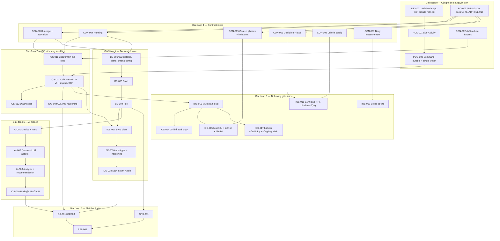

# 20. Kế hoạch triển khai hệ thống: thành phần và tính năng

**Phiên bản:** v0.1 (2026-11-08) · **Trạng thái:** PO duyệt 2026-11-08 (thứ tự giai đoạn, đường cắt MVP §9, các quyết định §10)
**Phạm vi:** toàn bộ hệ thống: iOS app, widget / Live Activity, backend .NET, sync, AI Coach, media, module Giáo án ([docs/18](18-plan-module.md)), nhiều giáo án ([docs/19](19-multi-plan.md)), sửa nội dung ([docs/17](17-content-editing.md)), brand / UI, vận hành và phát hành.
**Quan hệ với tài liệu khác:**
- [`16-implementation-plan.md`](16-implementation-plan.md) vẫn là chi tiết kỹ thuật cho C0, B0–B4 và I0–I6, gồm môi trường dev không tốn phí, thuật toán sync push/pull và CI.
- Tài liệu này thêm ba thứ: hiện trạng thực tế sau các PR đã merge, các tính năng mới của docs/17–19, và thứ tự triển khai cho toàn hệ thống.
- Tài liệu này **không thay thế** ADR hay contract. Nếu mâu thuẫn, ưu tiên theo quy tắc trong README.

> Không có ước lượng thời gian. Cột "Cỡ" (S/M/L) chỉ là cỡ tương đối, dùng để xếp thứ tự và chia PR. Mọi số đo hiệu năng phải đo thật rồi mới ghi (AGENTS: Performance).

---

## 1. Hiện trạng (có bằng chứng)

| Thành phần | Đã có | Chưa có / lệch so với docs/16 | Bằng chứng |
|---|---|---|---|
| Contract | OpenAPI 3.1, `entity-payloads.schema.json`, `catalog-bundle.schema.json`, `db/001`, `db/002` seed dev, `fixtures/`; CON-001 đã chốt (ADR-016..033) | Chưa có thực thể cho docs/18 và docs/19: goal, phase, activation, running, load, criteria config | `docs/reviews/CON-001-contract-review.md`, `handoff.yml` |
| Backend | B0: 5 project + DevToken; DbUp; JWT dev; ProblemDetails; health; rate limit; `GET /v1/me`; CI | B1–B4: catalog, plans, sync push/pull, auth Apple. Worker mới có heartbeat | `backend/`, 69 test (CHANGELOG B0) |
| CaliDomain | Reducer thuần, reconcile (clock jump, session cũ), FakeClock; fixture CON-002 **bản nháp** | CON-002 chưa duyệt; chưa có prescription `load` / running; chưa có logic vòng đời giáo án | `swift-domain.yml`, 73 test (sau CON-002 prep) |
| iOS app | POC UI đủ 5 tab, Player dùng reducer, recovery, sửa nội dung (IOS-009/MED-002), theme cam, 19 XCTest | Lưu bằng **một file JSON** (`LocalStore.swift`, `TODO(POC-003)`); không GRDB, không `processed_commands` / `sync_outbox` dạng bảng, không Diagnostics screen, không `LiveActivityIntent`; chỉ có **một** `plan` | run 42476165899 (commit `4a9ab4c`) |
| Widget / Live Activity | Extension render `ContentState` read-only, mang brand cam | Chưa có evidence thiết bị (POC-001); chưa có nút intent (POC-002) | `ios/CaliActivityWidget/` |
| Brand / UI | Token cam, `caliAccentInk` đạt 4.5:1, icon + brand assets cam, mockup toàn app | Chưa có duyệt logo cuối, kiểm tra nhãn hiệu, QA trên iPhone thật (light/dark, icon) | `validate_brand_assets.py`, `validate_coami_*` |
| Module Giáo án / nhiều giáo án | Đặc tả + mockup; PO đã chốt D1 (tối đa 3), nhập chạy tay, tổng hợp chéo | Các đề xuất D2–D9 của docs/19 và câu hỏi docs/18 §9 chưa thành ADR; chưa có contract | docs/18, docs/19 |
| AI Coach | Đặc tả docs/09, ADR-032 mapping; UI duyệt đề xuất dùng **dữ liệu mẫu** | Chưa có metric, queue, LLM adapter, API | `Features/AIReview/` |
| Media | Poster placeholder có nhãn; import từ Photos / Files, link HTTPS (chỉ local) | Chưa có media có giấy phép (MED-001); chưa dọn file import không còn dùng; chưa có contract đồng bộ nội dung cá nhân | docs/17 |
| Thiết bị | — | **Chưa có** lần sideload hay test iPhone nào được ghi evidence | `evidence/` chưa tồn tại |

**Lệch thứ tự so với docs/16 §4:** UI POC chạy trên dữ liệu local (`606030e`) được làm trước POC-001/002. Vì vậy kiến trúc lưu trữ (ADR-002 / ADR-013) vẫn **chưa có bằng chứng thiết bị**. Đây là cổng chặn đầu tiên (§4, Giai đoạn 0).

**Trùng ID backlog:** `IOS-009` đang dùng cho hai task: sửa nội dung (M1) và UI duyệt AI (M3). Đề xuất đổi task M3 thành **IOS-010** (§11).
> **Trạng thái (2026-11-08):** BL-001 đã áp dụng trong `contracts/backlog.csv` và docs/13.

---

## 2. Nguyên tắc xếp thứ tự

1. **Thiết bị trước kiến trúc lưu trữ.** POC-001/002 quyết định App Group và single-writer, nên phải có kết quả trước khi viết CaliCore / GRDB.
2. **Contract trước code** (AGENTS rule 7). Mỗi tính năng có dữ liệu mới đi qua một slice `CON-0xx` gồm ADR, OpenAPI, `entity-payloads`, SQL, fixtures, docs 03/07/08 và test validator. Slice code chỉ bắt đầu khi slice CON đã merge.
3. **Chỉ chuyển dữ liệu một lần.** Schema GRDB v1 được dựng từ bộ thực thể **sau** các slice CON-003/004 (lineage, activation, running), để snapshot JSON chỉ phải import một lần (BR-10 docs/19). Không làm GRDB theo mô hình một giáo án rồi phải chuyển lại.
4. **Logic thuần nằm trong CaliDomain** và test được trên Linux: vòng đời giáo án, tuần hiện tại, buổi bỏ lỡ, pace, kiểm tra giới hạn. Phút macOS chỉ dùng cho tích hợp Apple và XCTest.
5. **Lát cắt dọc nhỏ.** Mỗi PR một slice, có backlog ID, test và evidence.
6. **Không bàn giao nửa chừng.** Stub tạm phải ghi `TODO(ID)` kèm điều kiện hết hạn; dữ liệu mẫu luôn có nhãn.

---

## 3. Bản đồ thành phần

| Thành phần | Agent sở hữu | Công nghệ | Tài liệu chuẩn | Phụ thuộc chính |
|---|---|---|---|---|
| Contract (OpenAPI, schema, SQL, fixtures) | integrator + backend | YAML / JSON Schema / SQL | README §ưu tiên, docs/07, docs/08 | ADR trong docs/15 |
| CaliDomain | ios-agent | Swift thuần, chỉ Foundation | docs/03 | fixtures CON-002 |
| CaliCore (GRDB, coordinator, repo, sync engine) | ios-agent | GRDB, Swift 6 actor | docs/04, docs/08 | POC-002, CON-003/004 |
| CaliApp (SwiftUI) | ios-agent + design-agent | SwiftUI + Observation | docs/02, docs/18, docs/19, mockup | CaliCore |
| CaliActivityWidget + intents | ios-agent | ActivityKit, WidgetKit, AppIntents | docs/05, ADR-013 | POC-001/002 |
| Cali.Api / Application / Domain / Infrastructure | backend-agent | .NET 10, Dapper, DbUp, Npgsql | docs/06, docs/08 | CON slices |
| Cali.Worker (AI jobs, housekeeping) | backend-agent + ai-agent | BackgroundService, Postgres `SKIP LOCKED` | docs/09, ADR-006 | BE-004 |
| AI pipeline (metrics, rules, LLM adapter, evals) | ai-agent | .NET (hoặc module riêng trong Worker) | docs/09, ADR-007, ADR-032 | AI-001 |
| Media / catalog | design-agent + ios-agent | catalog bundle, AVKit, cache | docs/10, ADR-028 | MED-001 |
| Brand / design system | design-agent | Theme.swift, brand/ | brand guidelines, docs/02 | — |
| CI / ops / release | integrator-agent | GitHub Actions, Docker | docs/14, docs/16 §1 | — |
| QA / evidence | qa-agent | XCTest, xUnit, Testcontainers, iPhone | docs/12, `tests/acceptance.feature` | mọi slice |

---

## 4. Lộ trình theo giai đoạn



**Đường găng:** DEV-001 → POC-001 → POC-002 → IOS-001 → IOS-013 → IOS-007 → QA-002 → REL-001. Backend B1–B3 và các slice CON chạy song song với cổng thiết bị nên không nằm trên đường găng, trừ khi CON-003/004 chậm hơn POC-002.

### Giai đoạn 0 — Cổng thiết bị và quyết định

| ID | Việc | Agent | Cỡ | Đầu ra / DoD |
|---|---|---|---|---|
| DEV-001 | Sideload `.ipa` hiện tại (run 42476165899 hoặc mới hơn) bằng Sideloadly; ghi lại free account ký được extension hay không (P-01). Chạy ma trận docs/17 cho IOS-009/MED-002; QA hình ảnh theme cam (light/dark, icon trên Home Screen) | qa + ios | S | `evidence/DEV-001/` có video và bảng kết quả; cập nhật cột Evidence của docs/17; CHANGELOG |
| POC-001 | Theo docs/16 §5 và docs/05 §4: countdown trên Lock Screen / Dynamic Island, notification theo deadline, hành vi khi khóa, xác nhận App Group có khả dụng không | ios + qa | M | `evidence/POC-001/`; bảng ma trận docs/05 §5 |
| POC-002 | DB GRDB tối thiểu trong container app; `WorkoutCoordinator.handle` với `BEGIN IMMEDIATE` + dedupe; `LiveActivityIntent` gọi cùng coordinator; T-04, T-09, tap đồng thời | ios + qa | M | Báo cáo GO/NO-GO (docs/05 §6); nếu GO: ADR-013 Accepted, sửa ADR-002, docs/04, docs/05 trong cùng PR |
| PO-002 | Chốt thành ADR: docs/19 D2–D9 và câu hỏi mở §11; docs/18 §9 (rpe giữ cột riêng, lưu kg, sửa mục tiêu, adherence khi dời buổi); duyệt ADR-011..015 (đang ở trạng thái đề xuất) | integrator + PO | S | ADR mới trong docs/15 (tiếp từ ADR-034); docs/18 và docs/19 đánh dấu "đã chốt" |
| CON-002 | Duyệt `fixtures/reducer/*.json` bản nháp; bổ sung vector cho pause/resume, skip, abandon từ mọi phase | integrator + ios | S | Fixture được duyệt; CaliDomain đọc fixture và test pass trên Linux |
| BL-001 | Vệ sinh backlog: đổi `IOS-009` (M3) thành `IOS-010`; thêm ID mới của tài liệu này vào `contracts/backlog.csv` và `docs/13` | integrator | S | `validate_handoff.py` pass |

> **Trạng thái PO-002 (2026-11-08):** PO đã duyệt ADR-034..049 trong docs/15 (**Accepted**; ADR-048 là mặc định tạm tới usability test). CON-003/004 có thể bắt đầu. Gồm docs/19 D2–D9 (ADR-034..041), docs/19 §11.1–11.3 (ADR-042..044), docs/18 §9.1, 9.2, 9.5, 9.6 (ADR-045..048) và quy ước migration (ADR-049). Sáu câu hỏi mở (docs/18 §9.3, 9.4, 9.7; docs/19 §11.4–11.6) đã được PO trả lời và ghi thành ADR-050..055: tiêu chí áp theo bài từ v1 (vào CON-008, IOS-016), portal quản lý tất cả nội dung, chuyên cần theo lịch sau lần dời (vào IOS-011, IOS-015), không chuyển mục tiêu khi kết thúc, cho nhập bù, chỉ km. PO cũng đã duyệt ADR-011..015 (Accepted; ADR-013 vẫn chờ bằng chứng POC-001/002 trước khi sửa docs/04, docs/05). PO-002 hoàn tất. docs/18 và docs/19 đã đánh dấu "đã chốt" cho mọi mục mở.

> **Trạng thái POC-001 (2026-11-08):** code sẵn sàng, chờ build macOS + chạy trên iPhone. Đã có màn dev Cá nhân → POC thiết bị (`ios/CaliApp/POC`), không đụng UI thường. Màn này gồm: Live Activity riêng (cờ `deviceGatePOC`) với đồng hồ hệ thống vẽ từ deadline UTC đã lưu; thông báo tại deadline (id riêng); nút `+30s` / `Xong set` qua `POCLiveActivityIntent` (`authenticationPolicy = .requiresAuthentication`, thêm guard `isProtectedDataAvailable` trong app, không hứa thao tác khi đang khoá); dòng kiểm tra App Group; nhật ký `poc-events.jsonl` xuất được. Checklist và bảng kết quả trống ở `evidence/POC-001/README.md`. Chưa có cảnh báo nghỉ còn 10s. Chưa có kết quả thiết bị nào.

> **Trạng thái POC-002 (2026-11-08):** code sẵn sàng, chờ build macOS + chạy trên iPhone. Gói `ios/Packages/CaliCore` dùng GRDB 7.12.0, ghim chính xác trong `Package.swift` và `ios/project.yml`. `WorkoutCoordinator.handle` chạy `BEGIN IMMEDIATE`, dedupe theo `processed_commands` và ghi outbox trong cùng transaction. `commandId` tất định cho nút màn khoá. 19/19 test Linux đạt (T-04, T-09, ghi đồng thời từ hai connection). App và `LiveActivityIntent` gọi cùng một coordinator trong process app (ADR-013). DB riêng `Application Support/POC/poc-002.sqlite`; `LocalStore` giữ nguyên tới IOS-001. Checklist ở `evidence/POC-002/README.md`. Báo cáo GO/NO-GO chờ bằng chứng thiết bị.

> **Trạng thái CON-002 (2026-11-08):** fixture reducer **sẵn sàng review**, **chưa được duyệt**. Đã đọc lại `fixtures/reducer/*.json` theo docs/03 §4 và ADR-016..033, không thấy chỗ lệch giữa vector, reducer và docs/03 nên không sửa reducer. Thêm 3 file: `pause_resume_edge_cases.json` (30 bước), `skip_set.json` (22 bước), `abandon_from_every_phase.json` (32 bước). `ReducerFixtureTests` đọc toàn bộ 12 file; `swift test` trong Docker `swift:6.2-noble` (giống `swift-domain.yml`): 73 test, 0 lỗi. Trạng thái và bảng phạm vi ở `fixtures/reducer/README.md`. Việc còn lại: integrator + iOS duyệt (cùng POC-002 theo docs/13).

**Nhánh NO-GO của POC-002:**
- Nếu intent không chạy được khi app bị kill (P-06), nút trên Activity chỉ còn là deep link mở app. Bỏ `LiveActivityIntent` khỏi IOS-005.
- Nếu extension buộc phải đọc DB, cần App Group, tức là cần tài khoản trả phí (docs/16 §9). Khi đó IOS-001 dời DB vào App Group container và thêm test Data Protection (R-08).

### Giai đoạn 1 — Contract slices (song song với Giai đoạn 0 từ khi có PO-002)

Mỗi slice gồm: ADR, `contracts/openapi.yaml`, `contracts/entity-payloads.schema.json`, SQL migration, `fixtures/validation/business_rules.json` và fixture mẫu, docs 03/07/08 (và 09/11 nếu liên quan), test validator, contract test backend.

**Quy ước migration (ADR-049):** từ CON-003 trở đi, viết file **mới** `db/003_*.sql`, `db/004_*.sql`, không sửa `db/001` nữa. Lý do: kiểm thử đường nâng cấp bằng DbUp trước khi có DB thật được triển khai. *Trạng thái: đã chốt bằng ADR-049 (Accepted) trong docs/15.*

| ID | Nội dung | Phụ thuộc | Cỡ | Ghi chú |
|---|---|---|---|---|
| CON-003 | `training_plans`: `lineage_id`, `kind` (weekly / event), `event_date`, `event_name`, `primary_discipline`, `ended_at`, `end_reason`, `archived_at`; `status` đổi thành trạng thái phiên bản (current / superseded). Thực thể `plan_activation` có exclusion constraint I1, kiểm tra I2 trong transaction, mã lỗi `active_plan_limit`. Giới hạn 3 cấu hình được ở server; tổng 50 giáo án chưa xoá | PO-002 | L | docs/19 §10. Đây là slice rủi ro nhất về dữ liệu: cần test I1/I2 khi hai thiết bị offline cùng bật giáo án |
| CON-004 | `discipline` += `running`; `measurementType` += `distance`, `duration`; `set_result.distanceMeters`, `durationSeconds`, `source` (`manual`; `healthkit` dành cho sau); target chạy của `planned_exercise`; pace **không lưu** | PO-002 | M | Song song với CON-003 |
| CON-005 | `plan_goal` (indicator, baseline, target hoặc min/max, scope, unlockAfter, status, achievedAt, pinned) thay cho `training_plan.goal`; `plan_phase[]` sửa được, có audit; `indicator_definition` có phiên bản | CON-003 | L | docs/18 §6, §8. Mục tiêu "đạt" luôn do người dùng xác nhận |
| CON-006 | `exercise.discipline`, `exercise.measurementType`, `exercise.focusTags`; prescription kind `load` (`reps`, `loadKg`); `set_result.actualLoadKg` | CON-004 (dùng chung enum) | M | Reducer fixture cho `load` |
| CON-008 | `criteria_config` + `indicator_definition` chỉ đọc: `GET /v1/criteria-config` có ETag; `appliesTo.exerciseIds` (ADR-050); `set_result.criteriaVersion` + `criteria` (map, có giới hạn kích thước, JSONB). Quyền ghi chỉ dành cho portal (chưa làm) | CON-005, CON-006 | M | iOS gói sẵn một bản cấu hình mặc định để chạy offline |
| CON-007 | `body_measurement` (`kind`, `value`, `measuredAt`): dữ liệu nhạy cảm, mặc định **không** gửi cho AI | CON-005 | S | Cập nhật docs/09, docs/11 |
| CON-009 | Đồng bộ nội dung cá nhân (bài tập riêng, metadata media; **không** upload file): sở hữu, phân quyền, xung đột | sau BE-004 | M | Biên giới đã nêu ở docs/17. Có thể để sau pilot (§9) |

> **Trạng thái CON-004 (2026-11-08):** contract **đã review, đã commit**. Đã có `db/003_running_measurement.sql` (thêm `distance`/`duration` vào `exercise_type`; `set_results.distance_meters`, `duration_seconds`, `source` chỉ `manual`), target `distance`/`duration` ở OpenAPI và entity schema, enum `Discipline`/`MeasurementType` (chỉ định nghĩa, trường do CON-006 thêm), vector `business_rules.json` + `schema_rejections.json`, mẫu `fixtures/samples/running_sync_push.sample.json`, docs 03 §3.1, 07, 08. Pace không lưu. Logic CaliDomain thuộc IOS-011. Seed dev `db/002` chưa có bài chạy.

> **Trạng thái CON-003 (2026-11-08):** contract **đã review (PO duyệt ADR-056 ngày 2026-11-08)**. `db/004_plan_lineage_activation.sql` thêm lineage và các trường giáo án, `status` = `current|superseded` (ADR-056), bảng `plan_activations` (I1 exclusion constraint, I2 trigger với advisory lock, `active_plan_limit` = 3 trong `server_settings`), giới hạn 50 giáo án chưa xoá (`plan_count_limit`) và chuyển dữ liệu BR-10 (không ghi `sync_change_log`). OpenAPI/entity schema có `plan_activation`, mã lỗi mới; vector trong `business_rules.json`/`schema_rejections.json`, mẫu `fixtures/samples/plan_activation_sync_push.sample.json`, docs 03 §2.2, 07, 08. Kiểm thử SQL gồm hai thiết bị đồng thời cho I1/I2. Backend chưa có API sync nên ánh xạ SQLSTATE → `MutationError` làm ở B-slice; logic CaliDomain thuộc IOS-011.

> **Trạng thái CON-005 (2026-11-08):** contract **sẵn sàng review, chưa được duyệt**; ADR-057..059 ở trạng thái Proposed. `db/005_plan_goals_phases.sql` thêm `indicator_definitions` (có phiên bản, 6 chỉ số mặc định), `plan_phases` (thuộc phiên bản giáo án), `plan_goals` (thuộc lineage; trigger kiểm tra bất biến, cùng lineage, vòng `unlock_after` → `CA004`/`goal_unlock_cycle`, giới hạn ghim → `CA003`/`pinned_goal_limit` mặc định 3 trong `server_settings`), `plan_audit_events` chỉ thêm, ghi bởi trigger. Không có backfill vì chưa từng có cột `training_plan.goal`. OpenAPI/entity schema có `PlanGoal`/`PlanPhase`/`IndicatorDefinition`, hai mã lỗi mới; vector, mẫu `fixtures/samples/plan_goals_sync_push.sample.json`, docs 03 §2.3, 07, 08. Kiểm thử SQL gồm hai thiết bị cùng ghim mục tiêu thứ ba. Chưa làm: `GET /v1/criteria-config` (CON-008), ánh xạ SQLSTATE → `MutationError` (B-slice), tính `current`/`reached` (IOS-011).

> **Trạng thái CON-006 (2026-11-08):** contract **sẵn sàng review, chưa được duyệt**; ADR-060..062 ở trạng thái **Proposed**, chờ PO. `db/006_exercise_discipline_load.sql` (không phụ thuộc db/005) thêm `exercise_type` `load`, `exercise_catalog.discipline` (NOT NULL, backfill và trigger mặc định theo `type`) và `focus_tags`, `set_results.actual_load_kg` (0..1000 kg, tối đa 2 chữ số thập phân); không có cột `measurement_type` hay volume. OpenAPI/entity schema/catalog bundle có target `load`, `actualLoadKg`, `discipline`, `measurementType` (tính ra, `readOnly`), `focusTags`; vector mới trong `business_rules.json`, `schema_rejections.json`, `catalog_rejections.json`, mẫu `fixtures/samples/load_sync_push.sample.json`, fixture reducer `load_reps.json`; docs 03 §3.2, 07, 08. CaliDomain có prescription `load` và kiểm tra kết quả. App iOS đã có nhánh `load` trong các `switch` (`Formatting.swift`, `WorkoutEditorView`, `ResultFormView`, `MockData`, `Models`, `WorkoutPlayerModel`), chưa biên dịch: lần build macOS CI kế tiếp kiểm tra. **Việc còn lại:** backend ánh xạ vector load ở B-slice; bộ lọc `appliesTo.measurementTypes` thuộc CON-008.

### Giai đoạn 2 — iOS nền tảng local-first

| ID | Việc | Phụ thuộc | Cỡ | Test bắt buộc |
|---|---|---|---|---|
| IOS-011 | **CaliDomain mở rộng**, chỉ hàm thuần: prescription `load` và running; tính pace; trạng thái giáo án suy ra từ activation (docs/19 §4.2); tuần hiện tại theo D7 (weekly tính theo số ngày đã theo, event tính theo lịch tới ngày sự kiện); buổi bỏ lỡ theo từng giáo án; kiểm tra giới hạn 3 phía client; chọn thông báo gần nhất trong giới hạn 64 | CON-002, CON-003, CON-004 | M | Linux `swift test`; fixture `fixtures/plan-lifecycle/*.json` dùng chung với backend validation |
| IOS-001 | **CaliCore + GRDB v1** (thay `TODO(POC-003)`): bảng mirror thực thể sau CON-003/004, `processed_commands`, `sync_outbox` (chỉ enqueue, chưa gọi mạng), `sync_cursor`, `media_cache`, `local_session_state`; `WorkoutCoordinator` là actor duy nhất ghi DB (ADR-013); importer một lần từ `cali-poc.json`: giữ file gốc làm bản lưu, đánh dấu đã import, idempotent khi chạy lại | POC-002, IOS-011 | L | Migrate từ trống; import snapshot cũ (gồm cả snapshot trước IOS-009 không có `catalog`); dedupe command; rollback không để lại outbox mồ côi; 2 task cùng confirm; T-04, T-09 |
| IOS-012 | **Diagnostics screen** (chỉ dev build): OSLogStore, trạng thái DB, outbox, notification đang chờ, Activity hiện tại, base URL / JWT dev (Keychain); nút Export | IOS-001 | S | Export chạy được trên thiết bị; không lộ token trong log (AGENTS rule 6) |
| IOS-004h | Hardening Player trên CaliCore: "Target reached" chỉ gợi ý xác nhận (ADR-009), set result, rest +30s, abandon | IOS-001 | M | T-01, T-03, T-04, T-06; số đo confirm p95 trên thiết bị (docs/14) |
| IOS-005h | `LiveActivityBridge` cập nhật theo phase / revision; `NotificationScheduler` gắn ID `sessionId+revision`; intent theo kết quả POC-002; fallback khi Activity bị tắt hoặc quá 8 giờ | IOS-004h, POC-001/002 | M | T-02, T-05, T-11, T-12; ma trận docs/05 §5 |
| IOS-006h | `SessionReconciler` với dữ liệu GRDB; session quá 24h thì hỏi tiếp tục / kết thúc / bỏ; notes không hiện trên Lock Screen | IOS-001 | S | T-09, T-17 |

> **Trạng thái IOS-011 (2026-11-08):** **một phần, sẵn sàng review**. CaliDomain có thêm các hàm thuần: `LocalDate`; running (`RunningTarget`, `RunningResult.validate`, `Pace` theo min/km, từ chối quãng đường 0 và thời lượng quá 24h; `RunningFormat.kilometers`); `PlanLifecycle.status` theo docs/19 §4.2, `validateNewActivation` (BR-1, I1), `checkActivePlanLimit` (I2, giới hạn 3, cùng ngữ nghĩa với trigger db/004); `PlanSchedule.currentWeek` theo D7/ADR-039, `occurrences` và `adherence` (I4, dời buổi theo ADR-052, nhập bù theo ADR-054); `ReminderSelection.select` (gần nhất trước, tối đa 64, MP-13). Vector dùng chung ở `fixtures/plan-lifecycle/*.json` (6 file), chạy bởi `PlanLifecycleFixtureTests`; `swift test` trong Docker `swift:6.2-noble`: 88 test, 0 lỗi. Còn lại: prescription `load` (CON-006); đưa running vào `Prescription`, reducer và `ConfirmSet` (chờ CON-002 được duyệt); số tuần của giáo án lấy từ phase (CON-005, hiện truyền vào `totalWeeks`); trường dời buổi và nhập bù chưa có trong contract. Các quy ước tự đặt (ghi trong commit và fixture) cần integrator xác nhận, chưa phải quyết định của PO.

### Giai đoạn 3 — Tính năng giáo án (iOS, local-first)

Thứ tự UI bám mockup `docs/design/mockups/plan-module.html`. Mọi thao tác ghi đi qua `WorkoutCoordinator`, có `commandId`, có audit, chỉ dùng một nút **Lưu**, không hiện trạng thái đồng bộ trong luồng lưu (docs/02 UX-02).

| ID | Tính năng | Phụ thuộc | Cỡ | Tiêu chí / test |
|---|---|---|---|---|
| IOS-013 | **Nhiều giáo án local**: danh sách (đang theo / nháp / đã kết thúc / lưu trữ), tạo giáo án weekly hoặc event, bắt đầu theo với sheet giới hạn 3 và lựa chọn khi bắt đầu muộn, tạm dừng / kết thúc / kéo dài / lặp lại (D6), lưu trữ thay vì xoá (D8); Hôm nay gộp các giáo án; "Tuần của tôi" chỉ để xem và đánh dấu ngày trùng (D5) | IOS-001, IOS-011 | L | Gherkin docs/19 §8; chuyển trạng thái; I1/I2; bỏ lỡ theo giáo án; tuần hiện tại có tạm dừng (cả hai loại); lập lịch nhắc ≤ 64 |
| IOS-014 | **Ghi kết quả chạy**: P6 cho bài chạy (km + h:mm:ss, pace suy ra); kết quả giải cho giáo án event | IOS-013, CON-004 | M | Pace tính đúng ở biên (0, > 24h bị từ chối); `source = manual` |
| IOS-015 | **Mục tiêu, lộ trình, tiến bộ**: nhiều mục tiêu nhỏ, ghim tối đa 3, thang kỹ năng, người dùng xác nhận "đạt"; sửa giai đoạn (khoảng tuần tính tự động); màn Tiến bộ (baseline → hiện tại, delta, %, xu hướng tuần, adherence từ tuần 1) | IOS-013, CON-005 | L | Không tự đánh dấu đạt; đổi bài hoặc chỉ số thì tạo mục tiêu mới (docs/18 §9.5, sau khi chốt) |
| IOS-016 | **Gym load + P6 theo cấu hình động**: render form set từ `criteria_config` gói sẵn; `actualLoadKg`, lưu kg và hiển thị theo cài đặt | CON-006, CON-008 | M | Cấu hình không đọc được thì dùng bản gói sẵn; test kích thước map `criteria` |
| IOS-017 | **Lịch sử tuần / tháng + tổng hợp chéo**: UX-10 (docs/02 §3.1), lọc theo giáo án, "Tất cả" có tổng chéo; thẻ tuần ở Cá nhân (buổi, phút, km; không cộng set với km) | IOS-013, IOS-014 | M | So kỳ trước cùng khoảng đã trôi qua; trạng thái bỏ lỡ / bỏ dở / hôm nay |
| IOS-018 | **Số đo cơ thể** (opt-in), mặc định không chia sẻ cho AI | CON-007 | S | Bật/tắt chia sẻ có audit |

### Giai đoạn 4 — Backend và sync

Chi tiết thuật toán theo docs/16 §6. Bổ sung so với docs/16:

| ID | Việc | Phụ thuộc | Cỡ | Bổ sung so với docs/16 |
|---|---|---|---|---|
| BE-001/002 (B1) | `GET /v1/exercises` (+ cursor), `/v1/exercises/{id}`, `GET/POST /v1/plans`, `GET /v1/criteria-config` (ETag, 304) | CON-003/004 (+ CON-008 cho criteria) | M | Plans dùng lineage / activation; validation dùng chung với sync mutation |
| BE-003 (B2) | Sync push idempotent + receipt | B1 | L | Thêm thực thể `plan_activation`, `plan_goal`, `plan_phase`, `body_measurement`; I2 kiểm tra trong transaction khi khoá `user_sync_state`; trả `active_plan_limit` (không retry được, client hiện xung đột); exclusion constraint I1 |
| BE-004 (B3) | Pull theo cursor HMAC, tombstone, 410 | B2 | M | Payload cho thực thể mới (ADR-022) |
| IOS-007 | `OutboxSyncEngine` + pull + badge + hộp xung đột | IOS-001, B3 | L | Xung đột `active_plan_limit`: người dùng chọn giáo án tạm dừng, không tự xử lý; E2E iPhone ↔ cloudflared ↔ backend local (T-06, T-07) |
| BE-005 (B4) | `POST /v1/auth/apple`, refresh có rotate và phát hiện dùng lại, gitleaks, kiểm tra package có lỗ hổng | B3 | M | Test Apple thật chỉ khi có tài khoản trả phí (`TODO(BE-004-APPLE)` theo docs/16) |
| IOS-008 | Sign in with Apple + gắn dữ liệu guest vào tài khoản (docs/08 §6) | IOS-007, BE-005, tài khoản trả phí | M | T-16 |

### Giai đoạn 5 — AI Coach

| ID | Việc | Phụ thuộc | Cỡ | Điểm cần giữ |
|---|---|---|---|---|
| AI-001 | Metric tất định cho hold / reps / load / running (volume, pace, adherence theo **từng giáo án**); rule engine an toàn (docs/09 §5) | BE-004, CON-004/006 | M | Không lời khuyên y tế; dữ liệu số đo cơ thể chỉ dùng khi người dùng bật |
| AI-002 | Hàng đợi `ai_jobs` dùng `FOR UPDATE SKIP LOCKED` trong Worker; LLM adapter có output kiểm tra bằng schema; khoá provider để ở biến môi trường server (không bao giờ trong binary iOS) | AI-001 | M | Retry / backoff; T-13 |
| AI-003 | `POST /v1/analyses` idempotent theo `(session_id, session_revision, algorithm_version)`; recommendation gắn `planLineageId`, chuyển `superseded` khi giáo án thôi ở trạng thái đang theo; chấp nhận đề xuất tạo **plan revision** mới có audit | AI-002, CON-003 | M | ADR-007; T-14, T-15 |
| IOS-010 | UI duyệt AI dùng API thật thay dữ liệu mẫu: trạng thái pending / completed / rejected, áp dụng có xác nhận, nhật ký thay đổi | AI-003, IOS-007 | M | Không sửa giáo án ngầm (AGENTS rule 5) |
| AI-004 | Bộ eval: prompt injection trong ghi chú, dữ liệu thiếu, đề xuất tăng tiến không an toàn | AI-002 | S | Chạy trong CI ubuntu với provider giả |

### Giai đoạn 6 — Media, brand, vận hành, phát hành

| ID | Việc | Agent | Phụ thuộc | Ghi chú |
|---|---|---|---|---|
| MED-001 | Poster / thumbnail có giấy phép thay placeholder; cache manager tải trước buổi kế tiếp (Wi-Fi), AVPlayer | design + ios | UX-001 | R-07: giấy phép và người duyệt kỹ thuật động tác |
| MED-003 | Dọn file media import không còn được tham chiếu (docs/17: "storage-management slice"), có kiểm tra tham chiếu đang dùng | ios | IOS-001 | Không xoá media của session đang chạy |
| DES-001 | Duyệt logo cuối và kiểm tra nhãn hiệu; font Avenir Next cho brand board (hiện bị cắt chữ khi render) | design + PO | — | Concept giữ màu teal, chỉ để tham khảo |
| A11Y-001 | Audit trên iPhone: Dynamic Type lớn nhất, VoiceOver, high contrast, Reduce Motion, vùng chạm ≥ 44pt cho mọi màn của Giai đoạn 3 | qa + design | IOS-013..017 | T-18 |
| OPS-001 | CI/CD, secret, backup + restore drill, metric dashboard, feature flag (AI, Live Activity, prefetch, conflict UI nâng cao) | integrator | BE-004 | docs/14 §4 |
| QA-001 | Evidence M1: T-01..T-06, T-09..T-12 trên iPhone | qa | IOS-004h/005h/006h | Cổng phát hành |
| QA-002 | T-07, T-08, T-16, E2E hai thiết bị, xung đột `active_plan_limit` offline | qa | IOS-008 | Cần tài khoản trả phí |
| QA-003 | T-13..T-15, prompt injection, không có thay đổi giáo án ngầm | qa | IOS-010 | |
| REL-001 | Checklist pilot, TestFlight, playbook rollback | integrator + qa | QA-001/002/003, OPS-001 | docs/12 §5 |

**Ngoài MVP (ghi nhận, chưa lập kế hoạch):** portal web quản trị cho tiêu chí, chỉ số, danh mục bài tập và media (docs/18 §5.4, ADR-051); nhập dữ liệu chạy từ Apple Health (`source = healthkit`); nhập bù buổi quá khứ (đã chốt cho phép, ADR-054).

---

## 5. Làn song song theo agent

| Giai đoạn | integrator | backend | ios | ai | design | qa |
|---|---|---|---|---|---|---|
| 0 | PO-002, BL-001, CON-002 | (rảnh) sửa nợ B0 nếu có | DEV-001, POC-001, POC-002 | đọc docs/09, chuẩn bị fixture metric | DES-001 | evidence DEV-001, POC |
| 1 | điều phối CON-003..008 | soạn SQL migration + contract test | soạn fixture CaliDomain | — | rà mockup theo ADR mới | test validator |
| 2 | ADR-013 sau POC | B1 | IOS-011, IOS-001, IOS-012, hardening | AI-001 trên dữ liệu fixture | token / component cho màn mới | T-04, T-09, T-17 |
| 3 | — | B2, B3 | IOS-013..018 | AI-001 xong | A11Y-001 | Gherkin docs/19 §8 |
| 4 | OPS-001 | BE-005 | IOS-007, IOS-008 | AI-002 | MED-001 | QA-001, QA-002 |
| 5–6 | REL-001 | AI-003 (phần API) | IOS-010, MED-003 | AI-003, AI-004 | — | QA-003 |

Song song an toàn khi các slice không cùng chạm một artifact contract. Hai slice CON không được sửa cùng một `$defs` trong `entity-payloads.schema.json` ở hai PR mở cùng lúc; nếu buộc phải vậy, gộp lại thành một PR hoặc làm tuần tự.

---

## 6. Mẫu thẻ slice (dùng khi mở issue)

Dùng issue template ở docs/13. Mỗi thẻ phải ghi đủ các mục sau:

```text
ID / Title:              IOS-013 Multi-plan local
Owner:                   ios-agent
Depends on:              IOS-001, IOS-011, CON-003 (merged)
Touched paths:           ios/Packages/CaliCore/**, ios/CaliApp/Features/Planner/**, Features/Home/**, ios/CaliAppTests/**
Contract touched:        none (consumes CON-003)
Commands (commandId):    createPlan, startPlan, pausePlan, endPlan, extendPlan, repeatPlan, archivePlan
Tests:                   CaliDomain (Linux) lifecycle vectors; XCTest coordinator dedupe + I1/I2; UITest Today merge
Device evidence:         evidence/IOS-013/ (Today with 3 plans, limit sheet, overlap in My week)
DoD:                     Gherkin docs/19 §8 pass; CHANGELOG; docs/13 status; no new ADR unless lifecycle rule changes
```

---

## 7. Cổng chất lượng và CI

| Cổng | Áp dụng cho | Công cụ | Workflow |
|---|---|---|---|
| Contract hợp lệ | Mọi slice CON, mọi docs | `tools/validate_handoff.py` | `handoff.yml` (ubuntu) |
| Domain | CaliDomain, fixture | `swift test` trong `swift:6.2-noble` | `swift-domain.yml` (ubuntu) |
| Backend | build, unit, integration (Testcontainers), migrate từ DB trống, contract | `dotnet test` | `backend.yml` (ubuntu) |
| iOS build + XCTest | slice iOS | `xcodegen` + `xcodebuild` | `ios-build.yml` (macOS, `workflow_dispatch` với `run_tests`) |
| Design source | Theme / Components / brand | `validate_coami_*`, `validate_brand_assets.py` | chạy local trước PR |
| Device | slice chạm Lock Screen, timer, notification, media | ma trận docs/05 §5, docs/12 | thủ công, `evidence/<ID>/` |
| Accessibility | màn mới | Dynamic Type, VoiceOver, 44pt, contrast | thủ công + test contrast trong XCTest |
| Performance | confirm local, push 100 mutation, render Home | đo thật, ghi vào PR | không tuyên bố đạt khi chưa đo |

**Lưu ý CI:**
- `ios-build.yml` và `backend.yml` chỉ tự chạy khi push lên `main`. Trên nhánh feature phải chạy tay bằng `workflow_dispatch`, hoặc mở PR.
- Ghi thời gian mỗi job macOS vào bảng docs/16 §8 để theo dõi ngân sách khoảng 200 phút macOS mỗi tháng (P-02).
- Cổng chặn phát hành (docs/12 §5): T-02, T-04, T-06, T-07, T-09, T-11, T-14.

### Ánh xạ test ưu tiên → slice

| Test | Slice chứng minh |
|---|---|
| T-01, T-03, T-04, T-06 | IOS-004h (T-04 kèm IOS-001) |
| T-02, T-05, T-11, T-12 | POC-001, IOS-005h |
| T-07, T-08 | BE-003, IOS-007, QA-002 |
| T-09, T-17 | IOS-001, IOS-006h |
| T-10 | MED-001 |
| T-13, T-14, T-15 | AI-002, AI-003, QA-003 |
| T-16 | IOS-008, QA-002 |
| T-18 | A11Y-001 |
| Gherkin docs/19 §8 | IOS-013, IOS-014, IOS-017 |

---

## 8. Rủi ro của kế hoạch

Bổ sung cho docs/15 và docs/16 §10.

| ID | Rủi ro | Giảm thiểu |
|---|---|---|
| S-01 | Dữ liệu bị chuyển hai lần (JSON → GRDB một giáo án → GRDB nhiều giáo án) | Nguyên tắc 3: GRDB v1 chỉ bắt đầu sau CON-003/004 |
| S-02 | PO chưa chốt D2–D9 nên chặn CON-003 | PO-002 ở Giai đoạn 0; trong lúc chờ, backend làm B1 phần catalog và `/v1/me` không phụ thuộc giáo án |
| S-03 | Phạm vi module Giáo án quá lớn cho pilot | Đường cắt MVP ở §9; IOS-015/016/018 có thể dời mà không chặn sync |
| S-04 | Hai thiết bị offline cùng bật giáo án thứ 4 | I2 kiểm tra ở server, trả `active_plan_limit`, client hiện xung đột cho người dùng chọn; test trong QA-002 |
| S-05 | Giới hạn 64 thông báo chờ của iOS khi có 3 giáo án | Lập lịch ưu tiên gần nhất trong IOS-011, lập lại khi app active; notification chỉ là gợi nhắc |
| S-06 | Free account không ký được widget / intent | DEV-001 phát hiện sớm; fallback docs/16 §10 P-01, P-06 |
| S-07 | Trùng ID backlog gây nhầm evidence | BL-001 |
| S-08 | Hết phút macOS khi Giai đoạn 3 có nhiều PR UI | Logic dồn vào CaliDomain (Linux); gộp nhiều thay đổi UI vào một lần chạy XCTest; chạy macOS theo yêu cầu |

---

## 9. Đường cắt MVP pilot (PO duyệt 2026-11-08)

> PO đã duyệt bảng dưới đây làm phạm vi pilot. Mục ở cột "Sau pilot" chỉ vào pilot khi PO quyết định lại. Riêng điều khiển tương tác trên Activity phụ thuộc kết quả POC-002.

| Nhóm | Trong pilot | Sau pilot |
|---|---|---|
| Tập luyện cốt lõi | Player, Live Activity read-only, notification, recovery, nhật ký offline | Điều khiển tương tác trên Activity nếu POC-002 NO-GO |
| Giáo án | Nhiều giáo án (IOS-013), chạy (IOS-014), lịch sử tuần/tháng + tổng hợp chéo (IOS-017), mục tiêu cơ bản (IOS-015 phần goal + tiến bộ) | Thang kỹ năng nâng cao, sửa giai đoạn có audit chi tiết |
| Gym / cấu hình động | `load` + cấu hình gói sẵn (IOS-016) | Portal quản trị nội dung (ADR-051) |
| Sync / tài khoản | Push / pull, hộp xung đột, Sign in with Apple | Đồng bộ nội dung cá nhân (CON-009) |
| AI | Phân tích sau buổi, đề xuất cần duyệt | Đề xuất xuyên giáo án, dùng số đo cơ thể |
| Media | Poster có giấy phép cho bài trong giáo án mẫu | Video có giấy phép cho toàn bộ catalog |
| Khác | — | Apple Health, nhập bù buổi quá khứ (ADR-054), hiển thị lb (ADR-046). Quãng đường chỉ km (ADR-055) |

---

## 10. Quyết định cần chủ dự án

> **PO duyệt 2026-11-08:** cả năm mục dưới đây theo đề xuất của tài liệu này. Mục 2 và 3 đã thành ADR-034..055 (docs/15); mục 4 ghi ở §9; mục 5 lấy mốc muộn nhất là trước IOS-008 / QA-002, sớm hơn nếu POC-002 cần App Group.

1. Duyệt thứ tự: cổng thiết bị (Giai đoạn 0) trước GRDB, và GRDB sau CON-003/004 (nguyên tắc 1, 3).
2. Chốt các ADR của PO-002 (docs/19 D2–D9, docs/18 §9). Đề xuất: theo cột "Đề xuất" của từng tài liệu.
3. Quy ước migration: file `db/00N_*.sql` mới từ CON-003 hay tiếp tục sửa `db/001` đến lần triển khai đầu.
4. Đường cắt MVP ở §9.
5. Mốc mua Apple Developer (docs/16 §9). Theo kế hoạch này, mốc muộn nhất là trước IOS-008 / QA-002; sớm hơn nếu POC-002 cần App Group.

---

## 11. Thay đổi đề xuất cho backlog (`contracts/backlog.csv`, docs/13)

Áp dụng trong BL-001 sau khi tài liệu này được duyệt.

> **Trạng thái (2026-11-08):** đã áp dụng bảng này vào `contracts/backlog.csv` và docs/13 (tổng 53 task, không trùng ID, không có phụ thuộc trỏ tới ID không tồn tại). Phụ thuộc `IOS-013..017` của A11Y-001 được viết đầy đủ thành 5 ID. Regex ID của `tools/export_backlog.py` đã sửa thành `[A-Z][A-Z0-9]{1,3}-\d{3}` để nhận `A11Y-001`; CSV xuất lại từ docs/13 trùng khớp bản đã sửa.

| ID | Milestone | Owner | Depends on | DoD tóm tắt |
|---|---|---|---|---|
| IOS-010 | M3 | iOS | AI-003, IOS-007 | (đổi từ IOS-009 M3) UI duyệt AI nối API |
| DEV-001 | M0 | QA/iOS | — | sideload + QA thiết bị build hiện tại |
| PO-002 | M0 | Integrator | — | ADR cho docs/18 §9, docs/19 D2–D9, ADR-011..015 |
| BL-001 | M0 | Integrator | — | vệ sinh backlog |
| CON-003 | M1 | Integrator/BE/iOS | PO-002 | plan lineage + activation |
| CON-004 | M1 | Integrator/BE/iOS | PO-002 | running measurement |
| CON-005 | M1 | Integrator/BE/iOS | CON-003 | goals + phases + indicators |
| CON-006 | M1 | Integrator/BE/iOS | CON-004 | discipline + load |
| CON-007 | M1 | Integrator/BE/AI | CON-005 | body measurement |
| CON-008 | M1 | Integrator/BE | CON-005, CON-006 | criteria config read API |
| CON-009 | M2 | Integrator/BE/iOS | BE-004 | personal content sync |
| IOS-011 | M1 | iOS | CON-002, CON-003, CON-004 | CaliDomain mở rộng |
| IOS-012 | M1 | iOS | IOS-001 | Diagnostics screen |
| IOS-013 | M1 | iOS | IOS-001, IOS-011 | multi-plan local |
| IOS-014 | M1 | iOS | IOS-013, CON-004 | running entry |
| IOS-015 | M1 | iOS | IOS-013, CON-005 | goals / phases / progress |
| IOS-016 | M1 | iOS | CON-006, CON-008 | gym load + dynamic set entry |
| IOS-017 | M1 | iOS | IOS-013, IOS-014 | history week/month + cross-plan summary |
| IOS-018 | M1 | iOS | CON-007 | body measurement |
| BE-005 | M2 | BE | BE-004 | auth Apple + hardening (B4) |
| AI-004 | M3 | AI | AI-002 | eval suite |
| MED-003 | M1 | iOS | IOS-001 | media storage management |
| DES-001 | M1 | Design/PO | — | logo approval + trademark |
| A11Y-001 | M1 | QA/Design | IOS-013..017 | accessibility audit |

`IOS-001` cập nhật phụ thuộc: thêm `POC-002, IOS-011`; khi xong thì đóng `TODO(POC-003)` trong `LocalStore.swift`.
